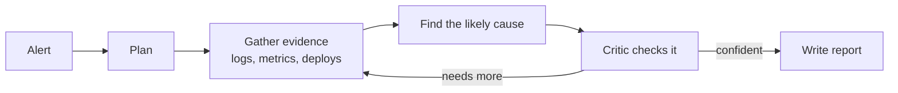

# Incident Investigator

AI agents that investigate a production incident the way an on-call engineer would.

You give it an alert, such as "checkout is slow". A team of six agents looks through
logs, metrics, recent deploys and service dependencies, works out the most likely
cause, has a critic double-check it, and writes a short report. Every claim in the
report points to the evidence behind it.

## Try it in 2 minutes

You need [uv](https://docs.astral.sh/uv/) and Python 3.13.

```sh
git clone https://github.com/knocBack/incident-investigator
cd incident-investigator
uv sync
```

**1. Run the demo (no API key needed).** It starts a small test shop, breaks it on
purpose, and runs the agents with pre-recorded answers:

```sh
uv run incident-investigator demo --model scripted --script tests/scripted-demo.json --out runs/
```

**2. Run it with a real AI model.** Get a key from [OpenRouter](https://openrouter.ai), then:

```sh
export OPENROUTER_API_KEY=your-key
export II_OPENROUTER_MODEL=deepseek/deepseek-v3.2
uv run incident-investigator demo --model openrouter --fault deployment_regression --out runs/
```

A run takes about 5 minutes and costs about $0.05. Each command prints where its
report is saved: open `runs/<run-id>/report.md` to read it.

Faults you can try: `bad_configuration`, `deployment_regression`,
`database_contention`, `resource_exhaustion`, `traffic_overload`.

## How it works



The agents only read a frozen copy of the evidence, never the live system. Today
that evidence comes from a built-in test shop. To use it on a real product, you
connect its monitoring data (for example Prometheus, OpenTelemetry or your alerting
tool). The agents themselves don't change.

## Project status

| | |
| --- | --- |
| Done | Test shop with 5 failure types, evidence tools, the six-agent investigation, automatic grading |
| In testing | A web dashboard to launch runs and watch the agents work |
| Next | Crash recovery, a 10-incident benchmark, and a comparison with a single agent |

Early result: with DeepSeek V3.2, the agents found the right cause in all 5 test
failures (one run each).

## Learn more

- [Usage reference](docs/usage.md): every command and option
- [Architecture](docs/hld.md) and [graph](docs/graph.md)
- [Evaluation plan](docs/evaluation-plan.md)
- [Design decisions](docs/decisions.md)

## Develop

```sh
uv run pytest -q
uv run ruff check .
```
