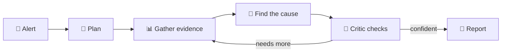

<div align="center">

# 🔎 Incident Investigator

**AI agents that find out why production broke and show you the proof.**

[](https://github.com/knocBack/incident-investigator/actions/workflows/ci.yml)


[Quick start](#-quick-start) · [How it works](#-how-it-works) · [What's next](#-whats-next) · [Docs](#-learn-more)

</div>

---

You get an alert: *"checkout is slow"*. Instead of you digging through dashboards at 3 AM, a team of six AI agents does it for you:

- 🧭 **Plans** what to check
- 📊 **Gathers evidence** from logs, metrics, deploys and service dependencies
- 🧠 **Finds the most likely cause**
- 🥊 **Lets a critic challenge it** before anyone trusts it
- 📝 **Writes a short report** in which every claim links to its evidence

## 🚀 Quick start

> You need [uv](https://docs.astral.sh/uv/) and Python 3.13.

```sh
git clone https://github.com/knocBack/incident-investigator
cd incident-investigator
uv sync
```

**Try the demo (no API key needed).** It starts a tiny test shop, breaks it on purpose, and lets the agents investigate:

```sh
uv run incident-investigator demo --model scripted --script tests/scripted-demo.json --out runs/
```

**Use a real AI model.** Get a key from [OpenRouter](https://openrouter.ai), then:

```sh
export OPENROUTER_API_KEY=your-key
export II_OPENROUTER_MODEL=deepseek/deepseek-v3.2
uv run incident-investigator demo --model openrouter --fault deployment_regression --out runs/
```

⏱️ About 5 minutes · 💰 about $0.05 per run · 📄 the report is saved to `runs/<run-id>/report.md`

<details>
<summary><b>Other failures you can try</b></summary>

| Fault | What breaks |
| --- | --- |
| `bad_configuration` | A timeout setting is changed to something far too short |
| `deployment_regression` | A new release makes a database query much slower |
| `database_contention` | Requests queue up waiting on database locks |
| `resource_exhaustion` | The database connection pool runs out |
| `traffic_overload` | Too many requests at once |

</details>

## 🧩 How it works



The agents only read a **frozen copy of the evidence**, never your live system. That makes every run safe and repeatable.

> 🔌 **Built to plug in.** Today the evidence comes from a built-in test shop. Connect your own monitoring (Prometheus, OpenTelemetry, your alerting tool) and the same agents can investigate your product. The agents themselves don't change.

## 📍 Where we are

| | |
| --- | --- |
| ✅ **Done** | Test shop with 5 failure types · evidence tools · six-agent investigation · automatic grading |
| 🧪 **In testing** | Dashboard to launch runs and watch the agents think |
| 🔜 **Next** | See below |

**Early result:** with DeepSeek V3.2, the agents found the right cause in **5 out of 5** test failures (one run each).

## ✨ What's next

Small steps, each one shippable on its own.

### 👀 Watch the agents think, live
A dashboard to start an investigation and follow every step, tool call and decision as it happens.

<p align="center">
  
  
</p>

### 🧾 Reports you can verify in one click
Every claim in the report links straight to the evidence behind it.

<p align="center">
  
</p>

### And then

- [ ] 🔔 **Start from a real alert:** an alerting webhook kicks off an investigation automatically
- [ ] 📈 **First real data source:** read live metrics from Prometheus
- [ ] 💬 **Answer in chat:** post the 3-line summary to Slack, with a link to the full report
- [ ] 🏆 **One agent vs a team:** a public scoreboard on 10 incidents
- [ ] 🎮 **Beat the AI:** a random hidden fault, and you race the agents to name the cause
- [ ] 💾 **Never lose a run:** resume an investigation after a crash

## 📚 Learn more

- [Usage reference](docs/usage.md): every command and option
- [Architecture](docs/hld.md) · [Graph](docs/graph.md) · [Design decisions](docs/decisions.md)
- [Evaluation plan](docs/evaluation-plan.md)

<details>
<summary><b>🛠️ For contributors</b></summary>

```sh
uv run pytest -q
uv run ruff check .
```

</details>

## Console

```sh
uv sync --locked
uv run incident-investigator console
# Open http://127.0.0.1:8765
```

The console binds only to loopback. It uses FastAPI, server-rendered HTML, and
small vanilla JavaScript files; there is no frontend build or account.

1. Open **Run evaluation**. Faults are discovered from `evals/expected/faults/*.json`
   and the lab registry. Select scripted, one or more faults, repeats, concurrency
   (default 2), and a limits profile. Review the CLI command, then launch.
2. The job page streams the real command's output and links completed attempts,
   including failed runs. One console job runs at a time; its batch concurrency
   remains configurable. Disconnecting the browser does not stop a job. Server
   shutdown stops its child process. Logs are capped at 2 MB and jobs at one hour.
3. Open a run's **Report**. Evidence citations link to saved observations or tool
   receipts. **Frozen evidence** browses the complete retained input snapshot,
   filtered by source, service, and time. Older runs without snapshots explicitly
   show only their retrieved evidence. Raw result JSON remains expandable.
4. **Grade** shows automatic checks alongside the evaluator's expected answer.
   Use **Grade this run** to invoke the real `eval` command. **Rubric** saves five
   human dimensions and reasons in a workspace sidecar. Expected answers and human
   notes never become investigator inputs or agent spans.
5. Open a suite for pass@1, pass@k, and pass^k by fault/model/recorded graph.
   Select k; the UI reports its effective value when fewer attempts exist.
   Failures remain in denominators. Compare two runs or suites under **Compare**.
   These are exploratory measurements; automatic correctness is not semantic proof.

OpenRouter launches require an explicit confirmation checkbox and a complete model
ID. The API key is read only from `OPENROUTER_API_KEY` in the server environment.
Use `eval-suite` for provider calls so its existing shared budget guard applies;
`demo` in the run panel is scripted only. The panel discovers graph options from
the CLI, so an unavailable graph cannot be launched. Empty or invalid settings
produce an error before spawning a process. POSTs require a per-console token and
same-origin requests; do not expose this local utility through a public proxy.

### Workspace and historical runs

Default output is one gitignored `./var` directory. Set `II_HOME=/absolute/path`
for a different home. Explicit `--out` remains supported.

```text
var/runs/<run_id>/       investigate and demo
var/suites/<batch_id>/   eval-suite, or separate eval grades
var/lab/<case>/          lab snapshots
var/lab/telemetry.jsonl  lab server telemetry
var/jobs/<job_id>/       command metadata, capped output.log, isolated eval input
var/reviews/<run-key>/   editable human-rubric.json
var/imports.json        external read-only roots
var/index.json          rebuildable metadata index
```

Each new investigation retains `snapshot/{manifest.json,alert.json,observations.jsonl,
fault-plan.json}` next to `report.md`, `result.json`, `trace.jsonl`, and `state.sqlite`.
The snapshot and run metadata are saved before graph execution, so unfinished
attempts remain inspectable even without a final report. The index labels them
`unfinished`, rather than implying they are still running. The snapshot contains
the exact frozen source, with its digest; grading expectations
remain separate. `eval` now defaults to a fresh workspace suite directory, preserving
original runs. Explicit `--out` selects a different grading destination.

```sh
uv run incident-investigator import /path/to/old-runs /path/to/old-suite
II_HOME=/tmp/ii-demo uv run incident-investigator console --port 8766
```

Imports index existing artifacts in place, without changing sources. Overlapping
roots resolve to a single run. New grades, human reviews, and jobs stay inside the
workspace. The index is rebuilt by scanning when pages are requested, so externally
created runs under the home appear without registration. Unknown usage remains
unknown; historical graph names use the shared graph-provenance mapping (`current` →
`hub`, `explicit` → `staged`; pre-selection runs used `hub`).

### Storage extension point

`storage.py` defines `ArtifactStore`, `RunRepository`, and `EvalCatalog` ports.
`IndexedRunRepository` handles metadata, filters, suite membership, and sorting;
it knows opaque artifact keys rather than filesystem layouts. File and memory
artifact adapters share a contract suite. File and memory eval catalog adapters
share discovery/expected-answer contracts. The console receives a `Repositories`
bundle by dependency injection, and never opens artifact paths.

The default factory uses filesystem storage; `II_STORAGE=memory` selects an
in-memory viewer/review backend (no subprocess launcher by default). A future
S3/MinIO adapter implements `ArtifactStore.read/write/list_keys/import_tree/location`
and is selected at the factory. Metadata/query logic and console callers remain
unchanged. The base adapter helpers publish CLI output and materialize isolated
local evaluator input; an object store can upload/download at that boundary.
No object-store dependency is installed. The local execution workspace is a
separate injected setting from blob storage. This MVP rescans local metadata;
large indexed deployments would warrant another `RunRepository` implementation.

### Optional Phoenix agent observability

The console handles evaluation and frozen evidence. **Phoenix** handles agent
behavior: prompts, model responses, tool calls, arguments/results, counts, usage,
cost and latency. It is off by default, local-only, and not needed for tests.

Install the exporter/instrumentation extra and run a separate local Phoenix
instance (the Phoenix server is deliberately not a project dependency):

```sh
uv sync --locked --extra phoenix
# Separate terminal; install/run the local open-source viewer:
uvx --from arize-phoenix phoenix serve
# Then enable capture in the run panel, or:
II_PHOENIX=1 uv run --extra phoenix incident-investigator demo \
  --model scripted --script tests/scripted-demo.json
```

`--trace phoenix` also enables export on investigate/demo/eval-suite.
`II_PHOENIX_URL` defaults to `http://127.0.0.1:6006`; only unauthenticated loopback
HTTP endpoints are accepted. Full actual model messages and responses are stored
locally in Phoenix when enabled. OpenInference LangChain instrumentation supplies
graph spans; explicit AGENT, LLM, and TOOL spans retain task/call IDs and usage for
our custom model adapters. Each run has its own trace/session identity. Fault
expectations and API credentials are not attached to these spans.

After export, `phoenix.json` records the trace ID and a deep link resolved through
Phoenix's local project API. **Open in Phoenix** appears when that URL is available.
A missing collector leaves the local report intact and records an unresolved link;
historical tracing-off runs show **not captured**. `trace.jsonl` and LangGraph's
SQLite checkpoints remain authoritative local artifacts; the console does not
rebuild a second Decisions/State/Telemetry GUI. LangSmith remains disabled.

To exercise explicit span parentage/payload checks with a local in-memory exporter:
`uv run --extra phoenix pytest -q tests/test_console_tracing.py`.
