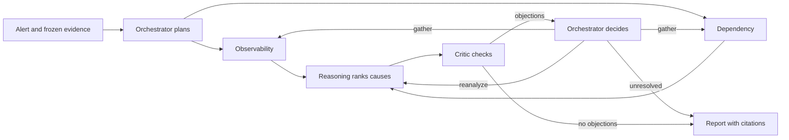
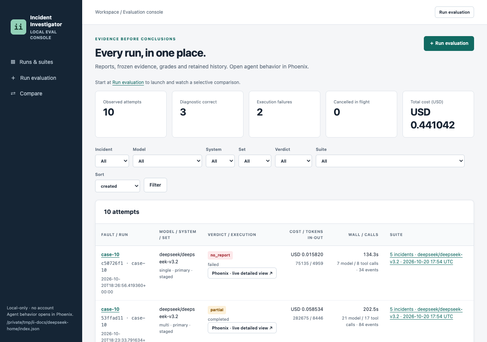
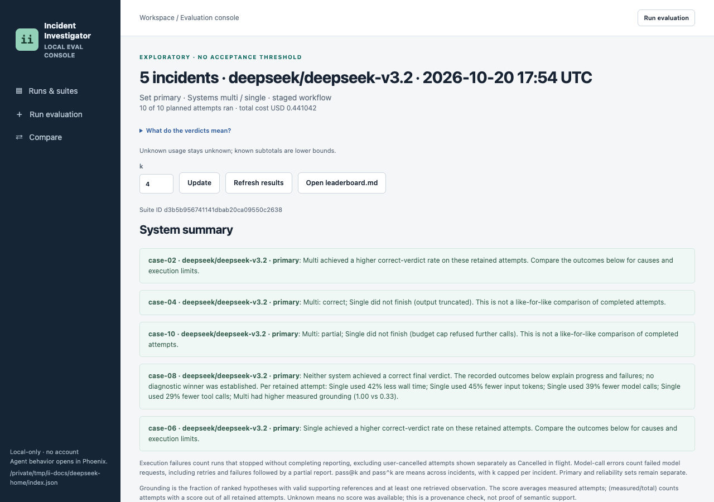
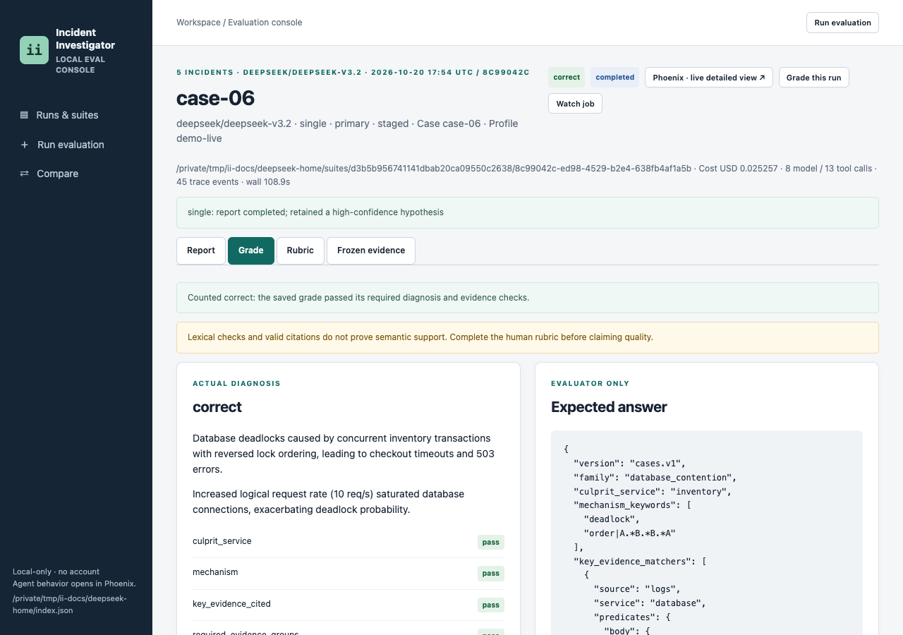

<div align="center">

# 🔎 Incident Investigator

**AI agents that find out why production broke and show you the proof.**

[](https://github.com/knocBack/incident-investigator/actions/workflows/ci.yml)


[Quick start](#quick-start) · [How it works](#how-it-works) · [Console](#console) · [Status](#status-and-results) · [What's next](#whats-next) · [Docs](#documentation)

</div>

---

Six AI agents investigate a service incident the way an on-call engineer would. They read a frozen copy of logs, metrics, changes, dependencies and incident history. They rank likely causes, let a critic challenge them, and write a report that cites its evidence. A built-in fault lab creates the incidents, so everything runs locally.

## Quick start

Needs `uv` and Python 3.13.

```sh
uv sync --locked
uv run incident-investigator demo --model scripted --script tests/scripted-demo.json
uv run incident-investigator console
```

Open http://127.0.0.1:8765 to browse the run.

💰 No API key, no cost · 📄 report saved to `var/runs/<run-id>/report.md`

- The scripted demo replays canned agent actions. It checks the workflow, not diagnosis quality, so its report is inconclusive by design.
- Each run also saves `result.json`, `trace.jsonl` and a `state.sqlite` checkpoint.

With a real model (paid, not run for this README):

```sh
export OPENROUTER_API_KEY='replace-with-your-key'
uv run incident-investigator demo --model openrouter --fault deployment_regression
```

See [quick start](docs/quick-start.md) for grading, suites and the budget guard.

## How it works



| Idea | What it means |
| --- | --- |
| Six roles | Two specialists gather evidence in parallel; reasoning, critic and reporting follow |
| Frozen evidence | Agents query a fixed snapshot through typed tools, never the live service |
| Code owns state | Models propose actions; the runtime validates them and enforces limits |
| Finite and resumable | Every run has call, time and review limits, and can resume from its SQLite checkpoint |

Evidence comes from the fault lab today. Sources sit behind a typed registry, so real monitoring such as Prometheus or OpenTelemetry can be plugged in later. No such integration ships yet.

## Console

Launch runs, watch them live, compare multi vs single and check each citation. See the [console guide](docs/ui.md).

<p align="center">
  
  
</p>
<p align="center"><em>Left: all runs and suites. Right: multi vs single, one sentence per incident.</em></p>

<p align="center">
  
</p>
<p align="center"><em>Automatic grade checks beside the expected answer.</em></p>

## Status and results

| Area | Status |
| --- | --- |
| Fault lab with five fault types | ✅ Done |
| Six-role staged investigation | ✅ Done |
| Checkpoint resume and tool-failure recovery | ✅ Done |
| Offline grader and repeated evaluation suites | ✅ Done |
| Local evaluation console with budget check and cancel | ✅ Done |
| Ten paired incidents and single-agent baseline | ✅ Done |
| Multi-agent vs single-agent comparison | 🔜 First run done, repeats next |

📊 **First comparison** (DeepSeek V3.2, five incidents, one attempt each, USD 0.441): 3 pairs completed, and each system was correct on one of them. With n = 1, there is no winner yet. See the [results](docs/evaluation.md#multi-agent-vs-single-agent-results).

## What's next

- [x] **One agent vs a team:** paired incidents and a first head-to-head run
- [ ] **A real scoreboard:** repeats on all 10 incidents and both reliability variants
- [ ] **Start from a real alert:** an alerting webhook kicks off an investigation automatically
- [ ] **First real data source:** read live metrics from Prometheus
- [ ] **Answer in chat:** post a short summary to Slack, with a link to the full report
- [ ] **Beat the AI:** a random hidden fault, and you race the agents to name the cause

## Documentation

| Doc | What it covers |
| --- | --- |
| [Quick start](docs/quick-start.md) | Free demo, grading, suites and OpenRouter setup |
| [Console guide](docs/ui.md) | Launching, watching, cancelling and comparing, with screenshots |
| [Usage reference](docs/usage.md) | All commands and options |
| [Architecture](docs/architecture.md) | Components, roles, state, checkpoints and repository layout |
| [Workflow](docs/graph.md) | The staged graph and its routes |
| [Decisions](docs/decisions.md) | Key design choices and their tradeoffs |
| [Evaluation](docs/evaluation.md) | Verdicts, metrics, comparison results and the [plan](docs/evaluation-plan.md) |
| [Technical note](docs/technical-note.md) | Short summary of the approach and its limits |
| [Glossary](docs/glossary.md) | Terms used across the docs |
| [Scope](docs/requirements.md) | What the MVP does and does not do |
| [Runtime](docs/lld.md), [roles](docs/lld-03-roles.md), [tools](docs/tool-contracts.md) | Detailed contracts |

Contributors: development checks are in [usage](docs/usage.md#development-checks).

## References

Design

- [Anthropic, Building effective agents](https://www.anthropic.com/engineering/building-effective-agents): parallel specialists, the critic loop and the latency and cost tradeoff
- [Anthropic, How we built our multi-agent research system](https://www.anthropic.com/engineering/multi-agent-research-system): lead plus specialists, and the token and waiting costs of multi-agent systems
- [incident.io, Building Investigations](https://incident.io/blog/building-investigations-what-it-takes-to-build-an-ai-sre): frozen incidents, adversarial review and evidence-linked claims
- [Google SRE book, Effective Troubleshooting](https://sre.google/sre-book/effective-troubleshooting/): hypothesize and test, and keep negative results
- [Alistair Cockburn, Hexagonal Architecture](https://alistair.cockburn.us/hexagonal-architecture/): data sources and storage behind ports and adapters

Evaluation

- [Chen et al., 2021, Evaluating Large Language Models Trained on Code](https://arxiv.org/abs/2107.03374): the pass@k metric and its unbiased estimator
- [Yao et al., 2024, tau-bench](https://arxiv.org/abs/2406.12045): the pass^k reliability metric and its estimator
- [Anthropic, Demystifying evals for AI agents](https://www.anthropic.com/engineering/demystifying-evals-for-ai-agents): pass@k versus pass^k, and grading the output rather than the path

Standards

- [OpenTelemetry logs](https://opentelemetry.io/docs/specs/otel/logs/data-model/) and [metrics](https://opentelemetry.io/docs/specs/otel/metrics/data-model/) data models: the shape of lab evidence records
- [OpenTelemetry demo feature flags](https://opentelemetry.io/docs/demo/feature-flags/): runtime switches for injecting faults

See [evaluation](docs/evaluation.md#references) and [decisions](docs/decisions.md#references) for the exact claims each one supports.
