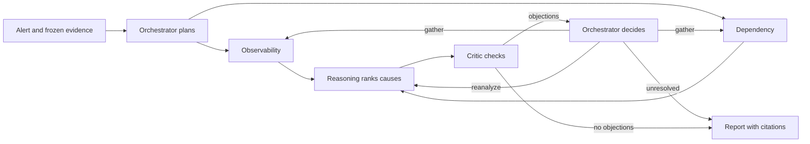

# Incident Investigator

A local, evidence-based incident investigator. Six agent roles inspect a frozen copy of logs, metrics, changes, dependencies and incident history, then produce a report with ranked causes, citations, uncertainty and recommended checks.

The built-in fault lab simulates a checkout service calling inventory and a database. It provides five controllable failures. Investigators read saved evidence through typed tools; they do not operate the live application.

## Why multiple agents?

Two specialists investigate different parts of the incident in parallel. A reasoning role compares their findings, and a critic challenges the explanation before reporting. This separates evidence collection from interpretation and makes disagreements visible. It also adds model calls, coordination and latency. Whether that cost improves diagnosis over one agent remains an evaluation question.

## Quick start

From the repository root, with `uv` and Python 3.13 installed:

```sh
uv sync --locked
uv run incident-investigator demo --model scripted --script tests/scripted-demo.json
uv run incident-investigator console
```

Open **http://127.0.0.1:8765**. The demo prints the report path under `var/runs/`; the console discovers it automatically. This sequence was verified on the current implementation. The scripted replay makes no model calls and intentionally reports **inconclusive**. It demonstrates coordination and retained artifacts, rather than model accuracy.

For a model-backed investigation, set a key in the shell that launches the command:

```sh
export OPENROUTER_API_KEY='replace-with-your-key'
uv run incident-investigator demo --model openrouter --fault deployment_regression
```

This uses the adapter's default model. Set `II_OPENROUTER_MODEL` to a complete provider/model ID to choose another, or use `--model-id`. Provider access, prices and availability vary. The command above can incur charges and was **not executed** during this documentation change. Use `eval-suite` for a shared monetary budget guard; see [quick start](docs/quick-start.md) and [usage](docs/usage.md).

## How it works



The staged LangGraph workflow checkpoints model and tool calls in SQLite. Runtime code owns IDs, validation, call limits, retries and evidence provenance. Interrupted runs can resume under their original deadline and limits. A missing response remains an unknown charged attempt; recovery does not promise exactly-once provider execution.

Every run retains `report.md`, `result.json`, `trace.jsonl`, `state.sqlite`, immutable configuration and frozen source data. The [console guide](docs/ui.md) explains reports, evidence, grading, comparisons and optional Phoenix traces.


## Evaluation status

The repository includes a deterministic grader, five lab fault families, scripted regression tests and a [historical exploratory re-grade](evals/results/exploratory-2026-10-19/README.md). That re-grade records **1 correct, 4 inconclusive and 5 missing reports** across ten early runs with changing configurations. It is not a controlled comparison or a current accuracy estimate.

### Upcoming multi-agent versus single-agent comparison

**Results pending.** The single-agent baseline, paired incidents and reliability variants are a separate evaluation change. A later benchmark and comparison report will use matched models, tools, budgets and incidents. No comparative scores are published here. See [evaluation](docs/evaluation.md) for metrics and the [evaluation plan](docs/evaluation-plan.md) for the accepted protocol.

## Repository map

| Path | Purpose |
| --- | --- |
| `src/incident_investigator/` | CLI, staged runtime, model adapters, storage and console |
| `src/incident_investigator/lab/` | Fault lab, load client and snapshot export |
| `src/incident_investigator/tools/` | Typed frozen-evidence retrieval and controlled failures |
| `fixtures/dev-00/` | Agent-visible development snapshot |
| `evals/expected/` | Evaluator-only expectations; never investigator inputs |
| `evals/results/` | Retained public evaluation summaries |
| `tests/` | Scripted and mocked checks; live provider tests are opt-in |
| `docs/` | User guides, design contracts and evaluation protocol |
| `var/` | Default local artifacts; gitignored |

## Documentation

Start with [quick start](docs/quick-start.md), [console guide](docs/ui.md) or [usage reference](docs/usage.md). Read [architecture](docs/architecture.md), [workflow](docs/graph.md), [decisions](docs/decisions.md) and the [technical note](docs/technical-note.md) for the design. The [glossary](docs/glossary.md) explains recurring terms.

For contributors:

```sh
uv sync --locked
uv run pre-commit install
uv run pytest -q -o tmp_path_retention_policy=none
uv run ruff check .
uv run ruff format --check .
```

Keep runtime sources isolated from evaluator expectations and preserve finite execution limits. See [requirements](docs/requirements.md), [runtime contracts](docs/lld.md), [role contracts](docs/lld-03-roles.md) and [tool contracts](docs/tool-contracts.md).
