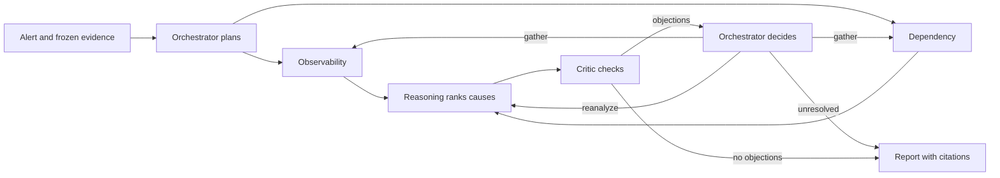

# Incident Investigator

A local team of AI agents that investigates a service incident the way an on-call engineer would. It reads a frozen copy of logs, metrics, changes, dependencies and incident history. It forms ranked hypotheses, has a critic challenge them, and writes a report that cites its evidence. A built-in fault lab creates the incidents, so everything runs on your machine.

## Quick start

Needs `uv` and Python 3.13. No API key is needed for these commands.

```sh
uv sync --locked
uv run incident-investigator demo --model scripted --script tests/scripted-demo.json
uv run incident-investigator console
```

Open http://127.0.0.1:8765 to browse the run.

- The scripted demo replays canned agent actions. It checks the workflow, not diagnosis quality.
- Its report is inconclusive by design.
- Each run saves `report.md`, `result.json`, `trace.jsonl` and a `state.sqlite` checkpoint under `var/runs/`.

With a real model (paid, not run for this README):

```sh
export OPENROUTER_API_KEY='replace-with-your-key'
uv run incident-investigator demo --model openrouter --fault deployment_regression
```

See [quick start](docs/quick-start.md) for grading, suites and the budget guard.

## How it works



| Idea | What it means |
| --- | --- |
| Six roles | Two specialists gather evidence in parallel; reasoning, critic and reporting follow |
| Frozen evidence | Agents query a fixed snapshot through typed tools, never the live service |
| Code owns state | Models propose actions; the runtime validates them and enforces limits |
| Finite and resumable | Every run has call, time and review limits, and can resume from its SQLite checkpoint |

## Status and results

| Area | Status |
| --- | --- |
| Fault lab with five fault types | Done |
| Six-role staged investigation | Done |
| Checkpoint resume and tool-failure recovery | Done |
| Offline grader and repeated evaluation suites | Done |
| Local evaluation console | Done |
| Ten paired incidents and single-agent baseline | In progress |
| Multi-agent vs single-agent comparison | **Results pending** |

The only retained model-backed results are an [early exploratory re-grade](evals/results/exploratory-2026-10-19/README.md) of ten development runs: 1 correct, 4 inconclusive, 5 with no report. Those runs used changing setups, so they are not an accuracy estimate.

**Multi-agent vs single-agent: results pending.** No comparison numbers exist yet. [Evaluation](docs/evaluation.md) describes the method.

## Documentation

| Doc | What it covers |
| --- | --- |
| [Quick start](docs/quick-start.md) | Free demo, grading, suites and OpenRouter setup |
| [Console guide](docs/ui.md) | The local console, with screenshots |
| [Usage reference](docs/usage.md) | All commands and options |
| [Architecture](docs/architecture.md) | Components, roles, state, checkpoints and repository layout |
| [Workflow](docs/graph.md) | The staged graph and its routes |
| [Decisions](docs/decisions.md) | Key design choices and their tradeoffs |
| [Evaluation](docs/evaluation.md) | Verdicts, metrics, results and the [plan](docs/evaluation-plan.md) |
| [Technical note](docs/technical-note.md) | Short summary of the approach and its limits |
| [Glossary](docs/glossary.md) | Terms used across the docs |
| [Scope](docs/requirements.md) | What the MVP does and does not do |
| [Runtime](docs/lld.md), [roles](docs/lld-03-roles.md), [tools](docs/tool-contracts.md) | Detailed contracts |

Contributors: development checks are in [usage](docs/usage.md#development-checks).
