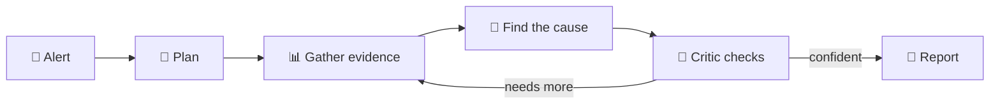
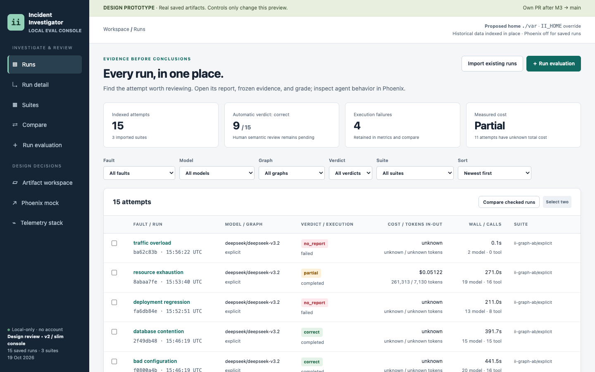
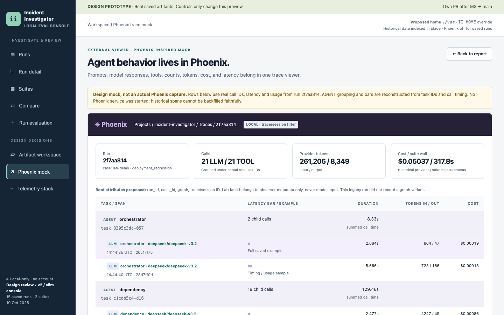

<div align="center">

# 🔎 Incident Investigator

**AI agents that find out why production broke and show you the proof.**

[](https://github.com/knocBack/incident-investigator/actions/workflows/ci.yml)


[Quick start](#-quick-start) · [How it works](#-how-it-works) · [What's next](#-whats-next) · [Docs](#-learn-more)

</div>

---

You get an alert: *"checkout is slow"*. Instead of you digging through dashboards at 3 AM, a team of six AI agents does it for you:

- 🧭 **Plans** what to check
- 📊 **Gathers evidence** from logs, metrics, deploys and service dependencies
- 🧠 **Finds the most likely cause**
- 🥊 **Lets a critic challenge it** before anyone trusts it
- 📝 **Writes a short report** in which every claim links to its evidence

## 🚀 Quick start

> You need [uv](https://docs.astral.sh/uv/) and Python 3.13.

```sh
git clone https://github.com/knocBack/incident-investigator
cd incident-investigator
uv sync
```

**Try the demo (no API key needed).** It starts a tiny test shop, breaks it on purpose, and lets the agents investigate:

```sh
uv run incident-investigator demo --model scripted --script tests/scripted-demo.json --out runs/
```

**Use a real AI model.** Get a key from [OpenRouter](https://openrouter.ai), then:

```sh
export OPENROUTER_API_KEY=your-key
export II_OPENROUTER_MODEL=deepseek/deepseek-v3.2
uv run incident-investigator demo --model openrouter --fault deployment_regression --out runs/
```

⏱️ About 5 minutes · 💰 about $0.05 per run · 📄 the report is saved to `runs/<run-id>/report.md`

<details>
<summary><b>Other failures you can try</b></summary>

| Fault | What breaks |
| --- | --- |
| `bad_configuration` | A timeout setting is changed to something far too short |
| `deployment_regression` | A new release makes a database query much slower |
| `database_contention` | Requests queue up waiting on database locks |
| `resource_exhaustion` | The database connection pool runs out |
| `traffic_overload` | Too many requests at once |

</details>

## 🧩 How it works



The agents only read a **frozen copy of the evidence**, never your live system. That makes every run safe and repeatable.

> 🔌 **Built to plug in.** Today the evidence comes from a built-in test shop. Connect your own monitoring (Prometheus, OpenTelemetry, your alerting tool) and the same agents can investigate your product. The agents themselves don't change.

## 📍 Where we are

| | |
| --- | --- |
| ✅ **Done** | Test shop with 5 failure types · evidence tools · six-agent investigation · automatic grading |
| 🧪 **In testing** | Dashboard to launch runs and watch the agents think |
| 🔜 **Next** | See below |

**Early result:** with DeepSeek V3.2, the agents found the right cause in **5 out of 5** test failures (one run each).

## ✨ What's next

Small steps, each one shippable on its own.

### 👀 Watch the agents think, live
A dashboard to start an investigation and follow every step, tool call and decision as it happens.

<p align="center">
  
  
</p>

### 🧾 Reports you can verify in one click
Every claim in the report links straight to the evidence behind it.

<p align="center">
  
</p>

### And then

- [ ] 🔔 **Start from a real alert:** an alerting webhook kicks off an investigation automatically
- [ ] 📈 **First real data source:** read live metrics from Prometheus
- [ ] 💬 **Answer in chat:** post the 3-line summary to Slack, with a link to the full report
- [ ] 🏆 **One agent vs a team:** a public scoreboard on 10 incidents
- [ ] 🎮 **Beat the AI:** a random hidden fault, and you race the agents to name the cause
- [ ] 💾 **Never lose a run:** resume an investigation after a crash

## 📚 Learn more

- [Usage reference](docs/usage.md): every command and option
- [Architecture](docs/hld.md) · [Graph](docs/graph.md) · [Design decisions](docs/decisions.md)
- [Evaluation plan](docs/evaluation-plan.md)

<details>
<summary><b>🛠️ For contributors</b></summary>

```sh
uv run pytest -q
uv run ruff check .
```

</details>
