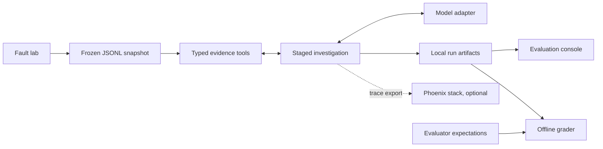

# Architecture

The system turns an alert and a frozen evidence snapshot into a report a human can inspect. The [glossary](glossary.md) defines snapshot, graph and other recurring terms.

## System boundaries

The lab is a small FastAPI application with checkout, inventory and database behavior. Its faults generate observable differences in logs, metrics and change records. `demo` exercises it in-process, exports a snapshot and investigates that snapshot. An investigation never queries the live lab.

The source loader validates a registered manifest, alert, observations and controlled tool-fault plan. It computes a digest that identifies the evidence set. Tools expose filters and bounded pages, rather than filesystem access. Expected answers are stored separately and used only after investigation. Runtime agents receive package prompts, task context and retrieved records; they are not given repository-reading tools.

## Six responsibilities

| Role | Responsibility | Output |
| --- | --- | --- |
| Orchestrator | Assign specialist questions and decide follow-up | Plan and objection dispositions |
| Observability | Examine logs and metrics | Cited findings and gaps |
| Dependency | Examine call relationships and changes | Cited findings and gaps |
| Reasoning | Compare explanations against accepted evidence | Ranked hypotheses, contradictions and uncertainty |
| Critic | Challenge one exact hypothesis revision | Objections and evidence questions |
| Reporting | Explain the reviewed result | Summary, facts, assumptions and recommended verification |

Observability and Dependency work concurrently. Reasoning waits for both to settle, including failures, so unavailable evidence remains visible. The critic can cause another targeted gathering or reasoning round. Reporting cannot retrieve new evidence or replace the ranked hypotheses. [Role contracts](lld-03-roles.md) specify the payloads.

## Calls and shared state

Each stage has `begin`, `commit`, worker and `settle` nodes. `begin` creates the stage's tasks. `commit` accepts prior receipts and admits bounded calls. Workers perform one model or tool operation and return immutable receipts. `settle` finishes the stage; conditional edges choose what follows. [Workflow details](graph.md) show the routes.

One authoritative control writer per step owns IDs, allowances, fault counters and accepted results. Parallel workers contribute to an identity-checking inbox reducer. A repeated identical receipt is safe; conflicting content under the same identity is rejected. This keeps one specialist from overwriting the other's findings and prevents parallel admission from spending the same allowance.

Model adapters share a completion interface. Scripted mode supplies explicit canned actions for tests. OpenRouter supplies structured chat completions. The optional local CLI adapter is isolated from ordinary project configuration and rejects observed tool execution, but its read-only process sandbox is not a filesystem confidentiality boundary. Do not expose evaluator files to a model process.

## Durability and finite execution

Synchronous SQLite checkpoints separate call admission, raw receipt persistence and result acceptance. The checkpoint is recovery authority; reports and traces are derived exports. Saved successful sibling responses survive an interrupted parallel step.

A per-run kernel lock rejects concurrent modifying invocations. Resume verifies source, prompts, tools, runtime, dependencies and checkpoint schema before opening the writable saver. It retains the original wall deadline, limits and consumed allowances. A call with no durable response is unknown; it keeps its charge and can retry with fresh identities only within remaining limits. Exactly-once external execution is not promised.

The local event-loop runner shares four active-call permits across investigations. Callers can impose smaller semaphores. Separate CLI processes have separate pools. Per-run limits also bound model calls, tool calls, retries, wall time and review rounds. Hard exhaustion exports a partial summary without another model call; failed control stages use Reporting when capacity remains. See [runtime contracts](lld.md).

## Artifacts and console

The default workspace is `var/`, overridden by `II_HOME`. Runs retain human and machine reports, traces, checkpoints, configuration/version metadata and the frozen input. Suites add grades, budget accounting and leaderboards. Imported roots are indexed in place and remain read-only; human reviews and new grades stay in the workspace.

The FastAPI console renders HTML with small JavaScript files. It receives storage repositories through dependency injection. `ArtifactStore` manages opaque keys; `RunRepository` indexes runs and suites; `EvalCatalog` supplies evaluator expectations. Filesystem adapters are the default, and memory adapters support isolated viewing/review tests. An object-store adapter and production telemetry integrations remain future work.

Every run writes its local trace to `trace.jsonl`. Export to the Phoenix stack is optional and restricted to loopback HTTP. Phoenix shows model/tool inputs, outputs, timing and available usage. The console adds the frozen evidence, expected-answer grade and human rubric. Neither source of traces replaces local recovery artifacts. See the [console guide](ui.md).

## Implementation map

| Module | Owns |
| --- | --- |
| `cli.py`, `lab/` | Commands, profiles, lab execution and snapshots |
| `sources/loader.py`, `tools/` | Source validation, retrieval, pagination and faults |
| `staged.py` | Stage subgraphs and conditional routes |
| `runtime.py`, `contracts.py`, `repair.py` | Admission, execution, validation and role exchange |
| `reliability.py`, `reporting.py` | Invocation ownership, compatibility and exports |
| `models/`, `telemetry/` | Model boundary and tracing |
| `grading/` | Offline verdicts, suites and budget guard |
| `storage.py`, `workspace.py` | Artifact access, indexing and workspace paths |
| `console.py`, `console_jobs.py`, `console_views.py`, `web/` | Local launch and review interface |

## Repository layout

| Path | Purpose |
| --- | --- |
| `src/incident_investigator/` | CLI, staged runtime, model adapters, storage and console |
| `src/incident_investigator/lab/` | Fault lab, load client and snapshot export |
| `src/incident_investigator/tools/` | Typed frozen-evidence retrieval and controlled failures |
| `fixtures/dev-00/` | Agent-visible development snapshot |
| `evals/expected/` | Evaluator-only expectations; never investigator inputs |
| `evals/results/` | Retained public evaluation summaries |
| `tests/` | Scripted and mocked checks; live provider tests are opt-in |
| `docs/` | User guides, design contracts and evaluation protocol |
| `var/` | Default local artifacts; gitignored |
