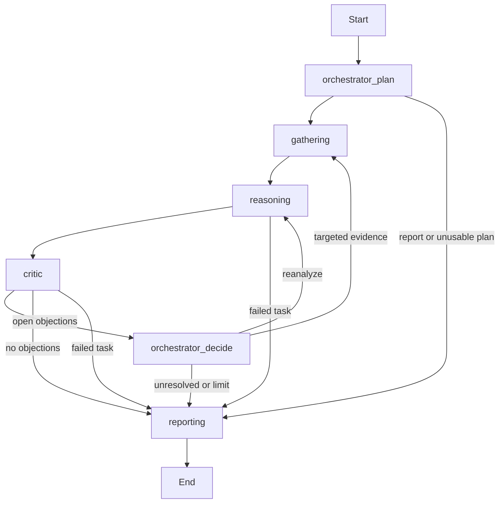

# Investigation workflow

The staged workflow is the only executable graph. No graph flag is needed. `--graph staged` remains accepted on `investigate`, `demo` and `eval-suite` so recorded workflow configuration and command previews stay explicit. Offline `eval` grades artifacts without executing a graph.

## Routes



The diagram emphasizes ordinary routes. Conditional edges also handle terminal control state. Hard run exhaustion exports partial artifacts without needing another model call; it does not guarantee a successful Reporting task.

## Inside a stage

`staged.build_staged_graph()` builds six stage subgraphs: planning, gathering, reasoning, critic, decision and reporting. Each has `begin -> commit`, parallel call workers returning to `commit`, and a `settle` exit. Conditional dispatch uses LangGraph `Send`.

Gathering shares one admission/commit loop between Observability and Dependency. Workers execute a single model/tool operation and publish immutable receipts through the inbox reducer. Only the commit boundary accepts evidence, updates counters and admits subsequent calls. It serializes the short control updates while external calls remain concurrent. The stage settles after all tasks have a terminal outcome; one failed worker does not erase another's result.

The same graph runs on initial invocation and resume. Synchronous SQLite checkpoints include nested stages. Saved worker responses can be committed after a sibling interruption without repeating completed work. [Runtime contracts](lld.md) explain unknown calls and version compatibility.

## Inspect the actual topology

This command prints the expanded Mermaid graph without model or tool calls:

```sh
uv run python - <<'PY'
import asyncio
from pathlib import Path

from incident_investigator.contracts import Limits
from incident_investigator.models import ScriptedModel
from incident_investigator.runtime import Investigation
from incident_investigator.sources.loader import load_snapshot

runner = Investigation(
    load_snapshot("dev-00"), ScriptedModel(), Path("."), Limits(), asyncio.Semaphore(4)
)
print(runner.graph().compile().get_graph(xray=True).draw_mermaid())
PY
```

Graph provenance is retained in results, trace events, grades, batch metadata and leaderboards. Imported historical runs keep their recorded workflow identity. They remain reviewable, even when their runtime version cannot be resumed.
