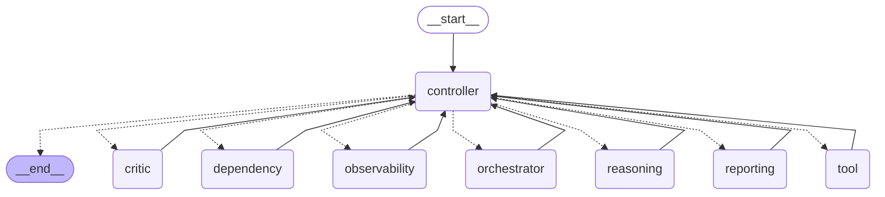
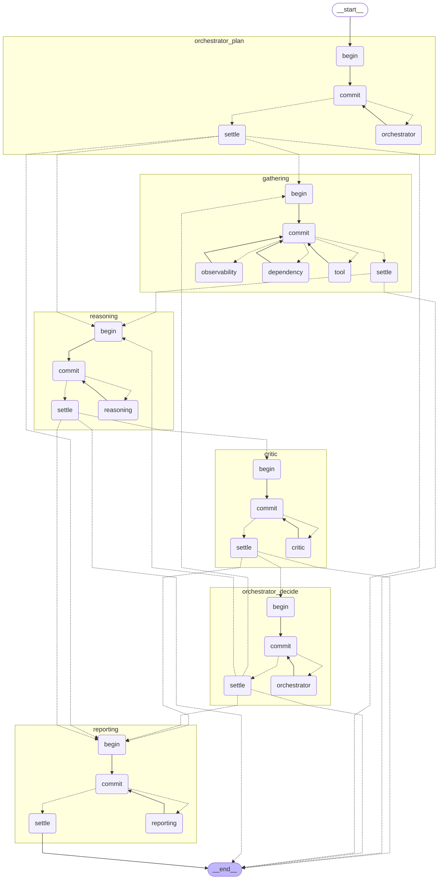

# Graph variants

`--graph current|explicit` is available on `investigate`, `demo`, and `eval-suite`.
The default remains `current`. Results, trace events, grades, batch metadata and
leaderboard rows record `graph`; leaderboard aggregation separates variants even
when all model selections match. Older artifacts without the field mean `current`.

The current graph centralizes workflow routing, receipt validation and call admission
in `controller`. Its advantages are a single owner of authoritative state, global
budgets and dedupe, parallel `Send` workers, and a checkpoint per external call.
Its topology hides the stage sequence inside `advance()`.

The explicit graph puts stage routing in conditional edges. Planning, gathering,
reasoning, critic review, orchestrator decisions and reporting are compiled subgraphs.
Each contains a model/commit loop; gathering also fans out individual tools with
`Send`. Expand subgraphs (`get_graph(xray=True)`) to see Observability and Dependency.
They share the gathering commit/admission boundary so simultaneous tasks cannot race
on global call budgets, fault counters, evidence provenance or cross-task dedupe.
These role workers run in parallel; stage transitions wait for the entire batch.

Both variants reuse the same task construction, prompts, schemas, call execution,
validation/repair/commit, ID allocation, provenance checks, admission limits,
dedupe, review accounting and report export. The explicit graph never calls
`controller()` or `advance()`. Its extra stage-entry/settlement checkpoints mean
revision numbers, checkpoint counts and wall time need not match the current graph.
`Control.stage` remains context for shared validation, not the workflow dispatcher.
Control has a single writer per superstep; parallel workers publish immutable
receipts through the identity-checking `inbox` reducer. Both use the same
`AsyncSqliteSaver` and `durability="sync"` at invocation; child checkpoints inherit
the saver. Global exhaustion exports the same partial fallback without another model
call. Failed control roles route to Reporting; failed Reporting retains partial artifacts.

## Inspect the compiled topology

This snippet builds both graphs and prints Mermaid without invoking a model or tool:

```python
import asyncio
from pathlib import Path

from incident_investigator.contracts import Limits
from incident_investigator.models import ScriptedModel
from incident_investigator.runtime import Investigation
from incident_investigator.sources.loader import load_snapshot

for variant in ("current", "explicit"):
    runner = Investigation(
        load_snapshot("dev-00"),
        ScriptedModel(),
        Path("."),
        Limits(),
        asyncio.Semaphore(4),
        graph=variant,
    )
    graph = runner.graph().compile()
    print(graph.get_graph(xray=True).draw_mermaid())
```

## Current



## Explicit



## Fast local comparison

```sh
uv run pytest -q tests/test_m3_agents.py tests/test_quality.py tests/test_graph.py
uv run incident-investigator eval-suite --graph current --model scripted --models scripted --script tests/scripted-demo.json --quick --faults all --budget-usd 0 --out /tmp/ii-current
uv run incident-investigator eval-suite --graph explicit --model scripted --models scripted --script tests/scripted-demo.json --quick --faults all --budget-usd 0 --out /tmp/ii-explicit
```

`--quick` runs the five fault jobs with concurrency 5. Each job receives the selected
graph alongside its own model adapter; graph labels remain distinct in the leaderboard.

The runtime E2E and quality scenarios are parametrized across both variants, covering
parallel gathering, follow-up review, validation repairs, task/global budgets,
no-progress/round/wall limits, tool timeout gaps, dedupe and Reporting fallback.
A cancellation/resume test rebuilds each graph from its SQLite checkpoints and
checks that completed model/tool calls are not repeated. CLI and grading tests check
variant selection and separate leaderboard groups. The demo script intentionally
reports an inconclusive diagnosis: these local runs check execution parity and
artifacts, not live model accuracy. No paid calls are needed for this comparison.
