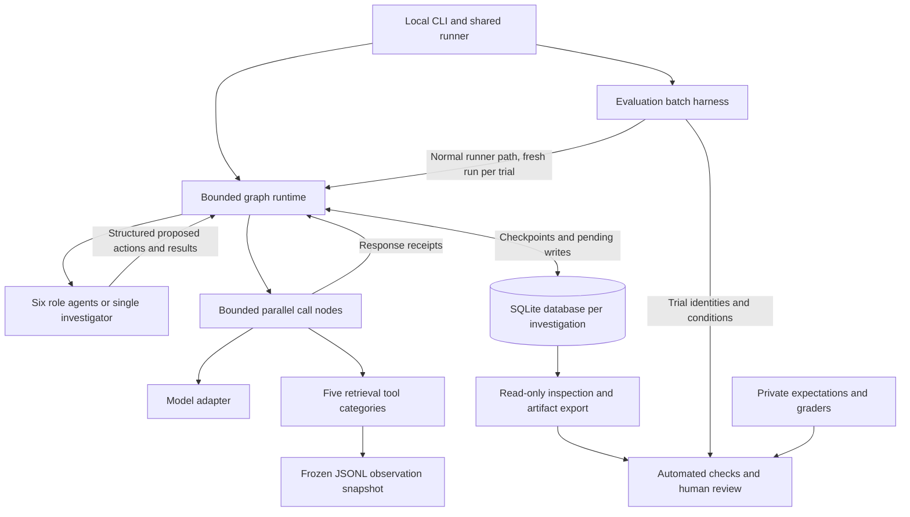

# HLD — incident investigation MVP

Status: core HLD complete and accepted as design, 2026-10-19. HLD-01/02 were accepted; Python + LangGraph and the architecture-first boundary were selected. The MVP review exposed under-specified supporting paths, retained in the delivery gap register rather than another architecture phase. [LLD-01](lld.md) specifies common state and one specialist lifecycle; [LLD-02](tool-contracts.md) specifies frozen JSONL sources, query/page/fault contracts, and controlled local settings. Candidate pins are now adopted in the lockfile; integration remains a separate validation gate. Open role/coordination contracts and settings are indexed in the [LLD handoff](lld.md#8-remaining-contracts-and-decision-gates). No application code, product reliability tests, graph integration results, or model evaluations exist yet.

Product requirements: [PRD](mvp-plan.md). Readiness review: [critical review](prd-review.md). This is developer design material; never provide it or other planning documents to runtime investigators.

## HLD-01: runtime owns commits to shared investigation state

Accepted logical rule: keep one structured investigation record per run, with one assigned owner per task. Agents receive read-only task context and return task-scoped structured results. Runtime code binds results to dispatched identities, validates them, and commits updates. Multiple agents contribute through separate tasks; they do not co-edit one mutable task result. Parallel calls remain parallel; only the short state commits are serialized within an investigation. This is an ownership rule, not a new server or storage service.

Why: if Observability and Dependency each return a replacement copy of the notebook, the later completion can erase the earlier findings. Agents also must not be able to reset budgets, turn an unavailable query into a healthy reading, or invent retrieved evidence.

Tradeoff: a shared live scratchpad would allow immediate cross-worker edits, but requires conflict handling and makes provenance harder to enforce. Committed snapshots fit the agreed parallel-round model. Workers learn another worker's new findings in the next dependent task; their own tool responses remain available during their task.

With LangGraph selected, distinguish durable node output from visible graph state: parallel nodes return updates, the runtime applies them at the step boundary, and successful nodes' pending writes can be saved before the whole step completes. The per-result commits in the example below express ownership and retention, not immediate cross-worker visibility. HLD-03 maps these boundaries; LLD specifies their exact encoding and transitions.

### Investigation, task, role, and attempt

An investigation is the complete incident run, including its evidence, tasks, conclusions, and budget. A task is one assignment with a specific question, assigned role, input context, prerequisites, expected result, and limits within that run's allowance. An agent role defines the responsibility; the same role can receive multiple tasks. An attempt is one execution of a task; a retry preserves the task ID and creates a new attempt ID. One task attempt may contain several separately identified model and tool calls.

| Task kind | Assigned role | Expected result |
| --- | --- | --- |
| Coordination | Orchestrator | An initial plan or next-step decision with assignments, prerequisites, and objection dispositions. |
| Observability | Observability | Findings from logs/metrics, evidence references, and missing coverage. |
| Dependency | Dependency | Findings from dependencies and deployment/configuration changes, with relevant historical evidence. |
| Reasoning | Reasoning | A ranked hypothesis revision with support, contradictions, assumptions, and uncertainty. |
| Critic | Critic | A review of an identified hypothesis revision, with objections and useful follow-up questions. |
| Reporting | Reporting | A report using the reviewed revision and recorded unresolved issues, recommendations, and verification. |

These are logical kinds, not final enums or schemas. Two roles can investigate the same broad incident question through distinct task IDs. Both can cite the same observation while retaining separate interpretations. Conflicting findings coexist for Reasoning to assess. Runtime success means a valid result was accepted; an inconclusive answer can qualify. Human task-quality grading is separate from runtime success and incident-level diagnosis accuracy. It judges assignment fulfillment and evidence support using the task's available inputs, rather than requiring every role to discover the final root cause.

## Ownership sketch

These are logical groups, not final classes, JSON keys, or database tables. All durable writes pass through the runtime.

| State group | Who proposes or supplies content | What runtime may commit |
| --- | --- | --- |
| Run identity and configuration | Validated CLI input and source/version metadata | Immutable run ID, alert, cutoff, mode, settings, limits, and version identities. |
| Plan and task registry | Orchestrator proposes questions, roles, and dependencies | Validated tasks with stable IDs; runtime alone changes execution status and selects active attempts. |
| Retrieved observations and query receipts | Tool executor supplies actual tool responses | Immutable source records plus query/attempt provenance and complete/partial/failed outcomes. Agents can cite these, not manufacture them. |
| Specialist findings | Owning agent task | Findings scoped to that task and its evidence references; conflicting findings coexist. |
| Hypothesis revisions | Reasoning Agent | Ranked explanations with support, contradictions, assumptions, and uncertainty; retain prior revisions. |
| Critic reviews | Critic Agent | Objections tied to the reviewed revision and proposed evidence questions; do not rewrite Reasoning's findings. |
| Report artifact | Reporting Agent | Report tied to the reviewed state revision, with validated structure and citation provenance. Semantic correctness still needs evaluation. |
| Attempts, usage, faults, and lifecycle | Execution and tool runtime | Reservations, attempts, available usage, persisted fault progression, deadlines, status, and stop reason. Models cannot set counters. |

The orchestrator coordinates hypothesis testing; it does not silently replace the Reasoning Agent. The critic requests follow-up; runtime validates it and the orchestrator turns it into assignments or an explicit unresolved issue. Reporting does not conduct an untracked second investigation.

Execution status and diagnosis remain distinct concepts. A normal run can end with an inconclusive diagnosis; a tool failure is not evidence of an application cause. Final field names and statuses belong to LLD.

### Minimum finding representation

Stable task and evidence identities, saved source observations, structured role exchange, and evidence-driven hypothesis revision are required by the PRD. A separately mutable lifecycle for every finding is not required. The smallest representation keeps findings inside their owning task result and creates a new reasoning result for a changed conclusion. Preserve earlier results and cited observations. Cross-task semantic deduplication, automatic finding invalidation, and continuous production-state synchronization are not needed to satisfy the MVP; introduce them only for a concrete need.

## Parallel completion example

This is a hypothetical ownership example, unrelated to any benchmark answer.

1. Runtime dispatches Observability task T1 and Dependency task T2 from committed revision S0. Each task receives its question, allowed tools, prerequisite results, and relevant committed context. No evaluator content is included.
2. T1 queries logs/metrics and T2 queries changes/dependencies concurrently. Runtime records tool attempts and receipts; each worker receives its own tool results. Retrieval records become shared evidence only through validated runtime commits.
3. T2 returns first. Its findings are retained under T2. T1 later returns; its findings are retained under T1. Neither result is a replacement of the full S0 record. Their visibility and durable commit points depend on the runtime mapping described above.
4. After the required tasks finish or become explicitly unavailable, runtime dispatches the dependent reasoning task with both committed results and relevant evidence. A failed worker does not erase the successful worker's work.

Timing and trace order may differ. For the same valid worker outputs, both completion orders must preserve the same observations and findings. This does not promise identical future LLM decisions.

## Merge and validation rules

- Runtime binds every result to the dispatched run, task, attempt, and input revision. A model's self-reported identity is not trusted.
- Results update only their permitted scope. Reject foreign-run references, invented evidence references, invalid structure, and writes to runtime-owned counters. Schema/citation validation does not establish that the diagnosis is true.
- Independent findings merge by stable identity. Reapplying the identical committed result is a no-op. A different payload under the same committed identity is a conflict, never a silent overwrite.
- A retry keeps the logical task identity but gets a distinct attempt identity. Runtime accepts a terminal result only from the eligible active attempt. A timed-out attempt's late result cannot replace its successor; any available usage still counts.
- Separate tool-returned observations from agent interpretations. Repeated retrieval may reuse a source observation, while query receipts and failed attempts remain individually auditable. Different content under one source-version/record identity is an integrity error.
- Preserve contrary findings. Reasoning resolves or describes disagreement in a new hypothesis revision; dictionary overwrite is not reasoning.
- Tasks depending on hypothesis or critic revisions must use the required revisions. Disjoint results from an earlier parallel snapshot can still be accepted; stale dependent reasoning cannot replace a newer accepted revision.
- Preserve committed results and attempt accounting across restart. The recovery contract below and HLD-03 specify the accepted boundaries and checkpoint mapping; exact schemas and transition implementation belong to LLD.

## Recovery contract

### Confirmed decision: retain unknown usage reservations and continue

The project owner selected **Keep reserve, continue** in the structured review on 2026-10-19. If a model call may have completed but its result and usage were not saved, retain the attempt's full reserved allowance. Continue or retry only within the original remaining execution limits. If another admissible attempt cannot fit, stop as resource-exhausted and preserve progress. Do not reset the allowance, treat missing usage as zero, or require manual review as the normal recovery path.

Keep measured usage separate from capacity held for admission. An unknown attempt remains unknown in reports even when its full reservation is charged against admission. Admission counts known usage plus active and unresolved reservations; known usage and the reservation for the same attempt must not both be charged. Reconcile an unresolved reservation only from reliable usage evidence. A retry has a new attempt identity and its own allowance.

Reservation sizes and per-call bounds must be validated against the selected provider/model before model runs. The experiments used arbitrary capacity units; their values are not execution-budget decisions or proof of a provider spending cap.

### Accepted durable boundaries

1. Before an external call, durably record the attempt identity and reserve capacity together. Admission must check and reserve against the current allowance atomically, so parallel tasks cannot spend the same remaining capacity. Release the database write transaction before waiting on an external call.
2. On receiving a response, durably save the response and any available usage before accepting its findings. A saved response with missing usage can still leave an unresolved reservation. Storage, schema, or provenance errors must not be converted into successful task completion.
3. Commit the accepted task result, its required evidence references, and task-completion status atomically. A completed task must not reference absent evidence. The stored response can be reused if this acceptance commit was interrupted.

HLD-03 maps these boundaries to synchronous graph checkpoints and saved call-node writes in one SQLite database per investigation. Preserve query receipts, fault progression, and the original configuration consistently with them. Exact state encoding and transaction/checkpoint transitions belong to LLD; there is no separate writer service or authoritative trace ledger.

| Saved state after interruption | Accepted resume behavior |
| --- | --- |
| Accepted task completion exists | Reuse its committed result; do not reissue its completed call. |
| Response exists but task acceptance is missing | Validate and commit the saved response without another external call. Invalid responses remain explicit and follow bounded failure handling. |
| Attempt exists but response is missing | Completion is unknown: retain its reservation and use a new attempt only if limits permit. A pre-dispatch crash and a post-call crash can look identical locally. |
| Acceptance transaction was interrupted | Recover a consistent task/result state; use the saved response to finish acceptance if necessary. |

Before recovery modifies a run, enforce the same-investigation exclusion policy. A stale marker file alone must not permanently prevent resume after the owning process has died. Late output from an older attempt cannot overwrite its eligible successor; available late usage still belongs to its original attempt.

## Intended verification

These are application checks to implement alongside the runtime, not product test results already obtained. The smaller feasibility experiments below exercise only selected primitives.

| Check | Expected behavior |
| --- | --- |
| T1/T2 complete in either order | Both tasks' evidence and findings survive; independent execution intervals overlap. |
| Retry/replay returns the same committed result | No duplicate finding; external attempts and available usage remain counted separately. |
| Reused identity carries different content | Reject conflict; preserve the original committed content and an error record. |
| Wrong run, fabricated citation, or budget write | Reject the update; preserve valid prior progress. |
| T1 fails, T2 succeeds | Retain T2, record T1 as unavailable/failed, and obey dependency rules. |
| Old attempt returns after retry | Cannot overwrite the accepted successor; do not discard known usage. |
| Resume versions are incompatible | Refuse before new model/tool work; preserve the checkpoint. |
| Saved response precedes task acceptance | Resume accepts it once without another external call. |
| Model response or usage is missing | Preserve unknown usage and its reservation; continue only within the original remaining allowance. |
| Parallel admission competes for limited allowance | Check and reserve atomically; combined admission cannot exceed the configured allowance. |
| Owning process dies | A later modifying invocation can acquire ownership; old marker files do not establish a live owner. |

Existing evaluation acceptance covers these behaviors at the product level. Exact fixtures and commit/recovery fault points follow once storage and task contracts are specified.

## Executed feasibility experiments — 2026-10-19

These were inline Python standard-library experiments. SQLite databases and lock files were temporary artifacts, removed after the checks. No application implementation or persistent regression suite was created. Commands and outputs are retained outside this public repository.

| Probe | Observed result |
| --- | --- |
| Pure merge of three immutable task results | All six completion orders retained the same three results. Identical replay was idempotent; compatible merges associated; inputs stayed unchanged; conflicting committed identity was rejected. |
| Process killed after reserving, before calling the fake tool | No external call occurred. Recovery retained the reservation and classified completion as unknown. |
| Process killed after the fake tool call, before saving the response | One external call occurred. Local saved state was identical to the preceding case; recovery retained the reservation and classified completion as unknown. |
| Process killed after saving the response | Recovery accepted the saved response without another fake-tool call. Repeated recovery created no duplicate accepted result. |
| Process killed during the acceptance transaction | Partial acceptance rolled back; recovery committed the saved response once. |
| Process killed after acceptance committed | Recovery reused the completed task without another fake-tool call. |
| Two concurrent SQLite connections each requested 60 units under a 100-unit cap | Exactly one was admitted. Unknown usage kept its reservation; replacing that reservation with known usage of 40 allowed a later request for 60. A second run's allowance remained isolated. |
| Process-held per-run file lock | A second modifier was rejected; another run proceeded. Killing the owner released the lock, and a later invocation acquired it despite the leftover file. |

SQLite integrity checks passed for all five crash-test databases. The external fake's call counter was an evaluator observation, not an oracle used by recovery. These results do not test real provider calls, power loss, fault-schedule recovery, schema/provenance validation, the application-wide concurrency scheduler, or any LangGraph integration. The probes preceded the Python/SQLite selection in HLD-03 and do not validate that selection. Package versions and execution limits remain open; arbitrary probe capacity units are not selected budgets. No application failure or diagnostic accuracy result was established.

## Real-world evidence and design implication

[LangGraph's concurrent-update documentation](https://docs.langchain.com/oss/python/langgraph/errors/INVALID_CONCURRENT_GRAPH_UPDATE) shows parallel branches writing one field raising an error without a defined reducer. A reducer is code that combines updates. The project implication is explicit ownership and identity-based merge; simple list concatenation alone does not provide retry deduplication. This earlier ownership evidence did not select the stack; HLD-03 subsequently selected LangGraph. Dependency pins remain open.

[Anthropic's multi-agent research account](https://www.anthropic.com/engineering/multi-agent-research-system) describes vague delegation causing overlapping work and synchronous rounds limiting information flow. Explicit questions and task-scoped results address overlap; waiting between rounds is an accepted MVP tradeoff. Background supervision remains deferred.

[incident.io's engineering account](https://incident.io/blog/building-investigations-what-it-takes-to-build-an-ai-sre) describes the evolution from narrative findings toward evidence-linked records, revision, and incremental updates. It supports separating observations from interpretations, but does not publish the write-locking or transaction mechanism for our concurrency problem. Its full mutable finding lifecycle is not an MVP requirement.

[LangGraph's runtime](https://docs.langchain.com/oss/python/langgraph/pregel) and [checkpointer documentation](https://docs.langchain.com/oss/python/langgraph/checkpointers) distinguish step-visible state from saved node writes. A checkpoint at a graph-step boundary is not automatically a checkpoint around every external call inside a node. The selected graph/node/task granularity must satisfy our recovery contract; missing usage and shared budget admission still need explicit application rules.

Read-only inspection of local Codex 0.163.0 and Claude Code 2.1.285 session stores found identified event/message records, tool-call/result relationships, and usage metadata. Codex also had SQLite thread/turn/item records with history offsets; Claude had separate subagent transcripts. This is evidence for explicit identity and saved execution state, not a stable file-format dependency or proof of exactly-once external calls. No credentials or unrelated conversation contents were copied into the design.

[Claude's documented resume behavior](https://code.claude.com/docs/en/sessions#what-a-resumed-session-restores) marks interrupted tool work and treats it separately from completed results. Its active-goal timer/token-spend baseline resets on resume; this is distinct from billing history and differs from our required preservation of consumed investigation budgets. [Codex's app-server contract](https://learn.chatgpt.com/docs/app-server) documents stored thread continuation and identified turns/items, without establishing exactly-once execution of external operations.

[SQLite's atomic-commit explanation](https://www.sqlite.org/atomiccommit.html) explains why related writes belong in one transaction. Our process-kill experiments support the acceptance boundary with SQLite primitives; they do not verify the subsequently selected checkpointer or all hardware failure modes.

## HLD-02: bounded investigation rounds and explicit dependency outcomes

**Accepted logical design, 2026-10-19.** Use the six fixed roles in a bounded, evidence-driven loop, with HLD-01's accepted ownership rule. The review separately settled dependency readiness, critic feedback, closure, and progress accounting. HLD-03 subsequently selects the backend and framework/checkpoint mapping; executable correctness remains unvalidated.

### Control flow and role boundaries

1. **Runtime preflight:** validate configuration; acquire modifying-invocation ownership; on resume, check compatibility and reconcile saved attempts/responses before new work. Preserve the original budget and the confirmed unknown-usage reservations.
2. **Orchestrator plans:** propose explicit questions, specialist assignments, prerequisites, and what each answer would distinguish. Runtime admits a finite, valid task batch. Initial independent Observability and Dependency questions can run together; follow-up need not invoke both roles again.
3. **Specialists gather:** Observability investigates logs/metrics; Dependency investigates changes/dependencies. Historical retrieval is available where relevant; exact tool permissions remain LLD. Run independent tasks and independent tool calls concurrently within configured limits. Each task has bounded calls, retries, and a deadline. Wait for the admitted batch to settle, preserving successful work when another task fails.
4. **Reasoning compares:** use the settled batch's accepted findings, retrieved observations, and explicit unavailable/partial outcomes to produce a new hypothesis revision. With no usable observations, an inconclusive result can be valid; failed retrieval does not establish an application cause.
5. **Critic challenges:** review that exact hypothesis revision. Return evidence-linked objections, missing distinctions, and useful follow-up questions, or explain why further investigation is unnecessary. A critic review can be valid while still containing objections.
6. **Orchestrator decides:** with the review and results, propose targeted gathering, reanalysis of existing evidence, or reporting. Every objection receives one traceable disposition: a targeted gathering task, a Reasoning task that reanalyses existing evidence and receives a new Critic review, or an explicit unresolved issue with a reason. Runtime validates the route and enforces limits. Models cannot clear objections merely by choosing to stop.
7. **Reporting closes:** use the latest reviewed hypothesis revision and the saved objection dispositions to produce the report. Preserve unresolved issues and uncertainty. Reporting does not retrieve new evidence or silently invent a revised diagnosis; a needed interpretation change returns to Reasoning and Critic within the remaining limits.

The skeleton is stable; the questions, retrieval choices, number of rounds, hypothesis changes, and follow-up route depend on evidence. This is not a fixed one-pass prompt chain. Background steering of active specialists remains deferred. Reasoning, Critic, and Reporting consume committed evidence rather than opening an untracked retrieval path.

### Small task lifecycle

These are logical states; final schema and names remain LLD.

| State | Meaning and transitions |
| --- | --- |
| Pending | Admitted, awaiting prerequisites, capacity, or an eligible retry. Readiness is derived, not a second durable status. |
| Running | Runtime admitted a distinct execution attempt. Model/tool calls inside it have their own recorded identities and limits. |
| Succeeded | Runtime atomically accepted a valid task result with its required evidence references and completion status. A partial tool response or inconclusive reasoning can still support a valid result. |
| Failed | No acceptable result after bounded handling, a permanent task error, or terminal closure after an execution attempt. Preserve the reason, attempts, usage, tool receipts, and valid saved evidence. |
| Skipped | Never attempted because a required prerequisite/input was unavailable, or because the run closed before the task's first dispatch. Preserve the reason. |

An eligible execution retry moves Running back to Pending only after recording the prior attempt outcome; it retains the logical task ID and gets a new attempt ID. Terminal task results are immutable. Revising a completed interpretation creates a new task/result, not a reset of Succeeded. Invocation interruption is a run condition: reconcile a saved Running attempt through the recovery contract rather than assuming it did no work. A process crash does not automatically fail or skip every task.

### Dependency readiness

Each dependency declares one of two conditions:

- **Require success and the required input:** dispatch only with the prerequisite's accepted result and the specific input needed by the dependent task. Use this for a discovered target or an exact hypothesis/review revision. A valid result can say the target is unknown; that does not supply an input for a target-specific query. If the required result or input is unavailable, skip the never-attempted dependent task with a reason; Orchestrator may choose an alternative evidence question.
- **Wait for settlement:** wait until the prerequisite is Succeeded, Failed, or Skipped, then supply its result or explicit failure record. Use this for Reasoning's specialist join, so one failed worker cannot erase another's work or stall the round forever.

Pending/Running prerequisites are not settled; a failed tool call alone does not necessarily fail the owning task. Available evidence and missing evidence remain distinct inputs. Reasoning may receive no usable observations and explain the resulting uncertainty within the remaining run limits. Critic requires a successful Reasoning revision. The Orchestrator's closing decision and Reporting require successful review/decision results tied to that revision. A successful review is not a promise that all objections were resolved. Readiness uses accepted runtime results, never private evaluator labels or a later human grade.

Runtime validates same-run identities, known prerequisites, role/output permissions, acyclicity, task-count limits, and required revisions before dispatch. It admits a proposed task batch atomically or rejects it with a recorded validation error; plan correction attempts consume bounded calls too. Independent tasks may share an older committed input snapshot; dependent tasks must receive their specified accepted results. A waiting task cannot occupy a worker slot indefinitely. If no work is running or dispatchable and no bounded retry/capacity wait can change that, stop with a scheduling failure rather than polling forever.

### Feedback, progress, and termination

A review round aims to produce one accepted Reasoning revision and its Critic review, with optional preceding gathering. Record its identity and consume round allowance when the round is admitted, including reanalysis without retrieval; failed or interrupted work does not refund that admission. Update the progress counter once when the review completes. Resume reuses the same round identity and accounting. A gathering batch settles when every admitted task is terminal; the next reasoning step waits for that boundary. This fits the agreed parallel-round MVP and does not imply immediate cross-worker visibility.

Runtime admits another round only within the original finite call/token allowances, round/task limits, retry limits, concurrency limits, and deadline. Numeric values are still open and must be fixed before model runs. Calls by all roles, invalid plans, failed attempts, and retries count. Repeating the Orchestrator or rewording a question cannot reset these counters.

For no-progress detection, compare actual retrieval outcomes after each completed review round. A new source observation or newly complete coverage for a normalized query, including a complete empty result, counts as retrieval progress; another task ID, duplicate source record, new prose, or another failed receipt does not. Persist the consecutive no-progress count. Critic-driven reanalysis of existing evidence can be useful and is allowed within the remaining thresholds and limits, but consumes round/call capacity without resetting the retrieval-progress counter. At the threshold, close further gathering and report the reviewed findings and gaps if required reporting work still fits. The exact query-normalization contract and threshold are LLD, recorded with the runtime version. This heuristic measures retrieval change, not diagnostic correctness; hard limits bound even superficially novel but useless queries. Semantic deduplication of arbitrary natural-language questions is not required.

| Condition | Accepted run behavior |
| --- | --- |
| Review supports reporting, no useful next investigation question remains, or no-progress threshold reached | Close gathering; Reporting may produce a completed report if required work fits the remaining limits, preserving objections and gaps. The diagnosis may be inconclusive. Lack of capacity alone is not this normal closure condition. |
| Specialist/tool failure | Retry eligible failures within limits, then settle explicitly. Continue reasoning with surviving evidence and failure records. |
| Orchestrator, Reasoning, Critic, or Reporting has no acceptable result after bounded handling | Fail the run; retain progress and a runtime-generated partial summary identifying the failed stage. Do not claim a reviewed completed report. |
| Hard round/task/call/token/deadline limit prevents required work | Stop as resource-exhausted. Preserve progress and a partial summary; do not require another model call to explain the stop. |
| Process interruption | Preserve the last durable state and resume through the compatibility/recovery contract, with the same counters and reservations. |
| Integrity/storage error or impossible scheduling state | Fail explicitly, preserving recoverable progress. Do not downgrade this to missing application evidence. |

The runtime-generated partial summary lists saved results, failures, resource accounting, and the stop reason. It does not synthesize a new diagnosis. A final Reporting call is subject to the same remaining limits as every other call; a polished report is not guaranteed after resource exhaustion. Execution outcome, stop reason, report completeness, and diagnostic conclusion are separate concepts.

If a hard limit prevents required work, record resource exhaustion even when no further task is admissible or the no-progress threshold also applies; do not relabel that as normal completion. Finishing the final report exactly at a cap does not itself imply exhaustion. Critical-role failure and integrity/storage errors remain explicit failure outcomes with their saved reasons.

### Terminal closure and late results

| Task at terminal closure | Saved outcome |
| --- | --- |
| Already terminal | Preserve the result and outcome. |
| Pending, never attempted | Skipped, with the closure reason. |
| Pending for retry after an earlier attempt | Failed, with the closure reason and prior attempts retained. |
| Running | End the attempt's eligibility to submit findings; record Failed with the closure reason, attempt cancellation, and preserve accounting. |

A response accepted before closure survives. If closure wins the acceptance race, a late response cannot change findings, but reliably obtained usage still belongs to its original attempt. Preserve unresolved reservations under the confirmed policy; requesting local cancellation does not prove that remote work or usage ceased. HLD-03 assigns ordering to serialized runtime transitions; exact cancellation and accounting transitions belong to LLD. Process interruption is distinct from terminal closure: reconcile saved attempts/responses during resume rather than applying this closure table to every unfinished task.

### Ownership and durability mapping

The lifecycle uses the accepted boundaries: reserve and save an attempt before dispatch; save a response and available usage before result acceptance; atomically accept the result/evidence references and terminal status. Record admitted plan batches, route decisions, objection dispositions, round/no-progress counters, and fault progression durably too. Retain their identities on replay; restarting must not create an extra round or duplicate follow-up batch. HLD-03 maps these transitions to the selected graph/checkpointer; LLD must specify their exact encoding and prove the integration before application behavior is called validated.

### Design walkthroughs, not executed product checks

- **One specialist fails:** Observability ends Failed; Dependency ends Succeeded. The settlement join allows Reasoning to use Dependency's observations and identify the missing coverage. A task requiring a target from Observability is Skipped.
- **Critic requests a distinction:** Orchestrator assigns a new targeted specialist question, waits for its outcome, then creates a new Reasoning revision and Critic review. The earlier evidence, hypothesis, and objection stay saved. If existing evidence suffices, a bounded reanalysis can address the objection without retrieval.
- **Repeated question adds nothing:** duplicate observations and changed prose do not reset the no-progress count. The configured threshold closes gathering; hard limits also bound reanalysis and superficially new queries.
- **Critical role fails or budget runs out:** no fabricated final report. A partial summary names the failed stage or resource stop and retains the surviving findings.
- **Interruption after a follow-up was admitted:** resume reuses the batch identity and prior counters. The saved attempt/response determines reuse versus an admissible new attempt; unknown usage keeps its reservation.

These are walkthroughs of the accepted logical design, not simulations, an implemented scheduler, or application acceptance results. After saving the decision checkpoint, the [evaluation specification](evaluation-plan.md#hld-checkpoint-cases--2026-10-19) added five focused groups for ownership, readiness, feedback, closure, and progress/resume. Their executable status is planned because runtime and runner are absent. A separate task-level human rubric judges assignment fulfillment, grounding/contradictions, and uncertainty without replacing final incident accuracy.

Real-world reference: [Anthropic's research-system account](https://www.anthropic.com/engineering/multi-agent-research-system), published 2025-06-13 and rechecked 2026-10-19, describes waiting for a parallel group as simpler coordination with delayed information flow. Our design implication is to accept that MVP tradeoff and bound waits with deadlines. This source does not establish our dependency semantics or retry correctness. The PRD's source-lessons table records the project rule and future verification.

## HLD-03: local runtime, durable calls, and baseline reuse

**Accepted architecture, 2026-10-19.** Python + LangGraph + local SQLite. Complete HLD at component, data-flow, persistence, concurrency, recovery, baseline, and validation boundaries. LLD follows before application implementation; selecting architecture does not establish executable reliability.

### Components and interfaces

| Component | Responsibility and boundary |
| --- | --- |
| Local CLI and runner | Start, inspect, resume, and evaluate runs. Own shared concurrency admission across investigations in that runner; support at least two progressing concurrently. |
| Graph runtime | Validate plans/results, derive readiness, admit calls, reserve budgets, schedule work, commit state, and close runs. Use serialized control transitions and bounded parallel call nodes. |
| Six role agents | Separate instructions, permitted actions, and structured outputs for Orchestrator, Observability, Dependency, Reasoning, Critic, and Reporting. Receive task-scoped context; never write shared state directly. |
| Model and retrieval adapters | One small model-call boundary returns response/usage or explicit error. Five structured retrieval categories query source observations and normalize receipts. No provider framework, plugin system, or extra backend is required. |
| Local persistence and artifact export | One SQLite database and graph thread per investigation. Immutable compatibility metadata accompanies checkpoints. Export Markdown reports, JSON results/configuration, and traces from saved state. |

Logical interfaces are a validated run request, a task-scoped agent input/result, a bounded model request/response, a structured retrieval request/receipt, and a saved-state inspection/export. Their field schemas, signatures, and error representations belong to LLD. Task attempts remain distinct from individual model/tool call attempts; replay must preserve completed calls within unfinished work.

The diagram shows component boundaries; HLD-02 defines the investigation loop. Runtime passes only selected agent-visible observations and task context to models. Synthetic source loaders and registered tools exclude planning documents, expected diagnoses, graders, and repository/shell access. Evaluators consume outputs separately; their private material never flows into agent inputs. No live application, HTTP service, distributed worker, or hosted tracing dependency is introduced.

### Delivery gap register

Accepted priority from the MVP review: make the investigation system functional first, while retaining gaps and closing each before its behavior is needed. Basic traceability and runtime enforcement accompany the first working slice. Richer observability is not a prerequisite project. These are design commitments, not implemented capabilities.

| ID | Minimum solution and owner | Completion trigger / current status |
| --- | --- | --- |
| GAP-DATA | Source loader binds a run to immutable versioned observations and a fixed incident cutoff, independent of execution wall time. Exclude records unavailable by the cutoff, metric windows extending beyond it, and later postmortems. Fresh retests reuse the snapshot with reset fault state; resume keeps saved source-fault progression. | Exact JSONL source/query/page/fault contracts are specified in LLD-02. Loader/tools/fixtures and executable checks remain planned. |
| GAP-OBS | Runner/controller/adapters capture correlated task/model/tool requests, receipts, errors, retries, timing, and measured usage. Inspection and derived local traces expose them; held allowances stay separate. Estimate monetary cost only with recorded model prices/settings. | Alongside the first executable lifecycle. Common records/events specified in LLD-01; integration absent. CPU/memory/disk sampling, dashboards, and hosted tracing deferred until the system works. |
| GAP-GUARD | Runtime validates allowed actions/tools, bounded inputs/retrieval/results, active ownership, evidence provenance, finite budgets/deadlines, and evaluator exclusion. Adapters treat evidence as data and keep credentials out of persisted traces. | Alongside each affected execution path. Common/source-specific enforcement is specified in LLD-01/02; implementation remains absent. No separate guardrail service is selected. |
| GAP-EVAL | Local batch harness selects cases/modes/repeats and freezes versions, settings, cutoff, faults, limits, and run order. It creates fresh trials through the normal runner; private graders consume saved outputs/traces and human semantic review, then produce per-case and aggregate results. Retain failures and unknown usage; no LLM judge. | Harness before comparison runs; finite configuration/spending bounds before real-model batches. Existing protocol retained; execution harness remains planned. |

Snapshot freezing reproduces available evidence and fault rules, not identical model choices or diagnoses. Exact source schemas and harness commands belong to their scoped LLD steps.

### Mapping calls and commits to LangGraph

Use the graph as a durable execution mechanism, not an autonomous state writer. The runtime retains HLD-01 ownership through these stages:

1. **Admit and reserve:** a serialized control transition checks dependencies/capacity and saves identified call attempts, allowances, and applicable fault progression. Persist with `durability="sync"` before releasing calls for execution. Never hold a database transaction while waiting on a model or tool.
2. **Execute and save receipts:** dispatch independent prepared calls through parallel call nodes, using `Send` where dynamic fan-out is needed. Each node performs one external call and returns its identified response, available usage, or error receipt. Do not hide a multi-call role loop inside one uncheckpointed node. Save raw responses before accepting or rejecting their semantic output; preserve successful sibling pending writes when another node fails.
3. **Validate and commit:** a subsequent serialized transition accounts for receipts, validates role outputs/provenance/eligibility, and accepts a task result and completion together, referencing saved evidence. Invalid outputs retain their receipts and usage and follow bounded handling. Continue unfinished tasks or admit their dependent work from committed state.

An admission or acceptance becomes authoritative only when durably saved. LLD must encode related updates so the checkpointer cannot expose completed tasks without results/evidence, and must verify checkpoint failures as well as process interruption. There is one authoritative recovery record; exported JSON or trace files cannot advance task or budget state.

Persist plan/round admission, routes, objection dispositions, progress updates, and source-scoped fault progression with stable identities. Tool faults remain retrieval failures, not application-cause evidence. Model/tool retries are runtime decisions with new call-attempt identities and allowances; disable hidden SDK and graph call retries. Do not use graph recursion limits as a substitute for persisted per-run limits.

### Resume, locking, and closure

- Acquire a process-owned per-investigation lock before modifying state. Reject a concurrent modifier; a leftover lock file is not a live owner. The runner owns shared capacity across its investigations; separate CLI processes do not imply a machine-wide concurrency service.
- Read immutable compatibility metadata before invoking graph execution or checkpointer setup/migration. Initially require exact matches for recorded source/contract versions and retain the original configuration. Refuse mismatches while preserving the checkpoint; automatic migration is deferred.
- Reconcile full checkpoints and successful pending writes. Reuse saved responses. A prepared call from an earlier invocation with no saved response is unresolved: keep its allowance, fence its findings eligibility, and issue another call only under a newly admitted identity and reservation. Bind dispatch to the current invocation so automatic node replay cannot silently repeat an old external call. Exact guard and state transitions belong to LLD.
- Retain the original evidence, budgets, faults, round identities, and progress counters. Repeated resume must not refund allowances, duplicate completed work, or consume an admission/progress update twice. Unknown measured usage stays unknown even when its full reserve limits further work.
- Serialize closure against result acceptance. Stop admitting work, end ineligible findings, request bounded local cancellation/collection, and retain reliably obtained usage. Remote work may outlive cancellation; unresolved usage retains its reserve. Do not require another model call for a partial summary.
- Inspection reads saved progress through a read-only path, without graph execution, schema setup, migration, or recovery writes. Label last-saved progress and pending work accurately. Exported artifacts must identify the saved revision and report completeness; they are rebuildable from persistence.

### Single-agent baseline and comparison

Use one investigator that can repeatedly select tools, consider evidence, revise hypotheses, and finalize the same report contract. It does not invoke the six separate role agents. Reuse the model adapter, retrieval implementations, receipt/provenance validation, persistence, recovery, resource accounting, and artifact export. Each fresh baseline or multi-agent run receives independent state and reset faults; neither inherits the other's retrieved evidence.

Use identical underlying model settings, source observations, tool contracts, and total per-run resource limits. Internal coordination/task/round guards remain explicit for each mode; they do not grant extra model/tool allowances to individual specialists. Preserve all attempts and report both modes honestly under the existing comparison protocol.

### Evidence and validation gate

[LangGraph's checkpointer documentation](https://docs.langchain.com/oss/python/langgraph/checkpointers), rechecked 2026-10-19, describes synchronous persistence before the next step and recovery of successful sibling writes. Problem: those boundaries do not automatically protect every API call inside a long node. Project rule: explicit admission, call receipt, and acceptance stages with invocation-bound replay handling. Verification: controlled graph/checkpointer crash and sibling-failure checks before real-model runs. Invocation fencing, budget accounting, and source/version compatibility are application rules, not guarantees supplied by the framework.

The [Python Graph API](https://docs.langchain.com/oss/python/langgraph/graph-api) documents dynamic `Send` routing and runtime context; the [SQLite saver source](https://github.com/langchain-ai/langgraph/blob/main/libs/checkpoint-sqlite/langgraph/checkpoint/sqlite/aio.py) exposes checkpoint and pending-write persistence and performs setup on read paths. This supports selecting the mapping, not claiming integration correctness or that ordinary saver reads are non-mutating. Pin compatible releases and verify the read-only inspection path during LLD/integration.

The planning-session package probe attempted `langgraph==1.2.16` and `langgraph-checkpoint-sqlite==3.1.2` with local Python 3.13 in an isolated temporary uv environment. It was a historical probe; dependencies are now locked, while graph integration remains separately unvalidated.

The validation path is controlled doubles against the real graph/checkpointer, then integrated tools/agents, then exploratory model measurements. Extend existing checkpoint groups for the chosen mapping and cover missing call-recovery boundaries in the [evaluation specification](evaluation-plan.md#hld-03-checkpoint-cases--2026-10-19). All executable checks remain planned until their runtime and dependencies exist. The ten incidents, two reliability variants, mandatory deterministic acceptance, and later diagnostic-threshold selection remain unchanged.

## LLD handoff

HLD-01, HLD-02, and HLD-03 are accepted design.

**LLD-01 is specified in [LLD](lld.md):** common run/task/attempt/call/receipt/evidence/result records, identity merges, small interfaces, checkpoint/replay transitions, one specialist walkthrough, and minimum local telemetry/guardrails. It is not an implemented or validated runtime, nor the complete LLD for all six roles.

**LLD-02 is specified in [tool contracts](tool-contracts.md):** frozen JSONL sources, five typed queries, page versus source completeness, query-coverage identity, source-scoped deterministic faults, native component reuse, and a saved controlled-test profile. Dependencies are now locked; graph smoke validation remains pending.

The [remaining-contracts handoff](lld.md#8-remaining-contracts-and-decision-gates) consolidates open decisions, their accepted sources, completion gates, and existing verification groups. Dependency adoption and real graph/checkpointer checks precede validation of the first specialist lifecycle; other role/coordination contracts precede their affected behavior. Provider/model and validated reservation/spending bounds precede real-model calls; benchmark configuration/harness precedes comparison batches. Keep GAP-DATA/OBS/GUARD/EVAL visible without postponing unrelated functional work.

Workspace procedures are outside this product-design handoff. This documentation reconciliation selects no new architecture, schema, numerical setting, provider, or acceptance target. Design acceptance, documentation checks, integration validation, and measured diagnostic acceptance remain separate.
