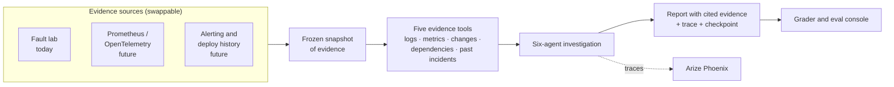
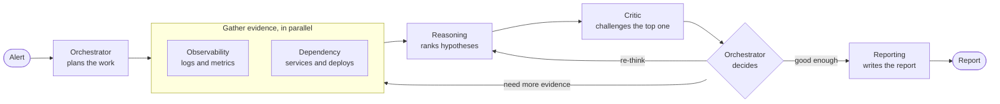
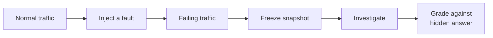

# Architecture

## The big picture

**Built to plug into real systems.** The agents never talk to a live system. They only call five narrow evidence tools over a frozen snapshot. Today the snapshot comes from a synthetic fault lab. To investigate a real product, you add adapters for its telemetry (OpenTelemetry, Prometheus, a log store, alerting tools such as Alertmanager, deploy history). The agents, prompts, graph and grading do not change.

## How the agents coordinate

| Role | Job |
| --- | --- |
| Orchestrator | Splits the alert into tasks, then decides after each critic review: gather more, re-think, or report |
| Observability | Looks for the signal in logs and metrics |
| Dependency | Checks the services involved, recent deploys and config changes |
| Reasoning | Ranks possible causes, each backed by cited evidence |
| Critic | Raises objections to the top hypothesis |
| Reporting | Writes the final report, including any objections still open |

**Rules that keep it trustworthy**

- **Agents propose, code decides.** Models return structured JSON. The runtime validates it, assigns IDs, enforces budgets and moves the work forward.
- **Evidence must be real.** A hypothesis can only cite evidence that was actually retrieved in that run.
- **Bounded.** Each run has hard limits on calls, time and critic rounds. When it hits one, it still writes a partial report.
- **"Not sure" is allowed.** Gaps and unresolved objections are shown, not hidden.

**Graph.** Each stage is its own node in a LangGraph graph (the "staged" graph, now the default). Inside a stage, agent and tool calls run in parallel. A small commit step keeps one trusted writer for shared state. An older single-hub version is kept behind `--graph hub` and is deprecated.

## The eval loop

The expected answers (culprit, mechanism, key evidence) are never shown to the agents.
