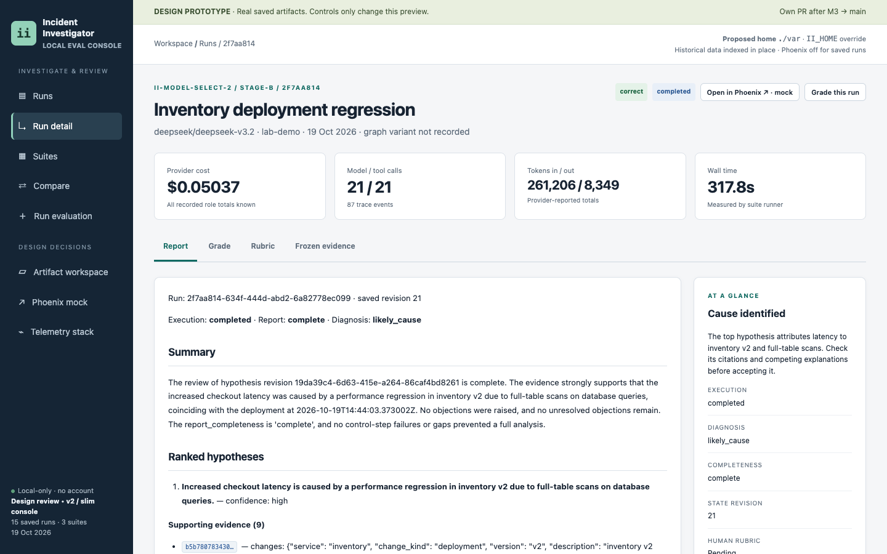
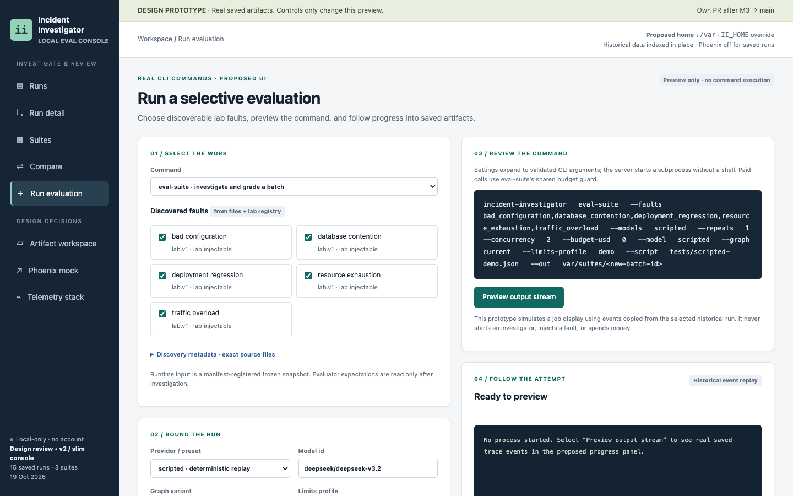

# Eval console (in testing)

A local web console to launch evaluations and review results. Agent behaviour (prompts, tool calls, tokens, timing) opens in Arize Phoenix. The console covers what Phoenix doesn't: the frozen evidence, grades against the expected answer, and the leaderboard.

Status: implemented in [PR #12](https://github.com/knocBack/incident-investigator/pull/12) and in testing. The screens below are from the approved design, built on real saved runs. Features not in the MVP, such as human grading, are hidden or greyed out.

## All runs in one place

## One run: report, grade and frozen evidence

## Launch a selective evaluation

## Agent trace view (Phoenix)

<!-- Add screenshots of the running console here once PR #12 lands:

-->
