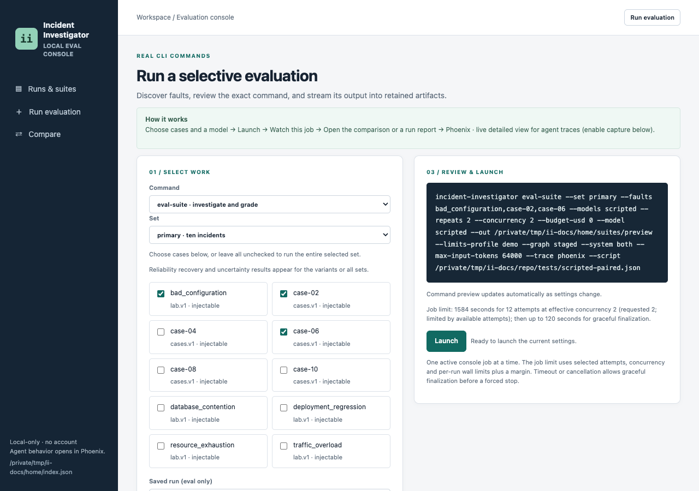
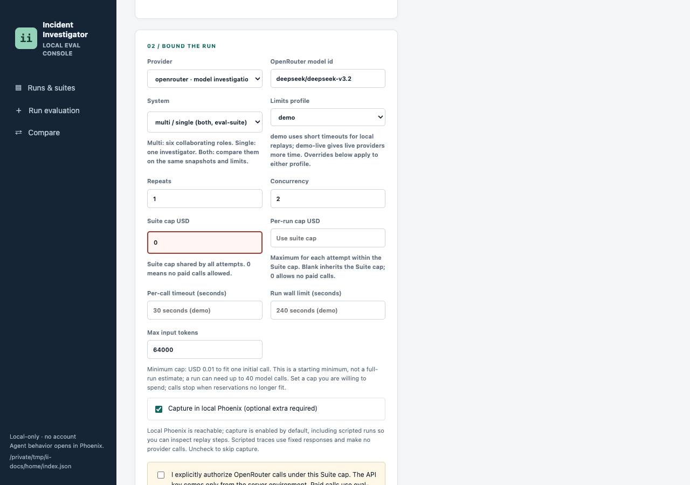
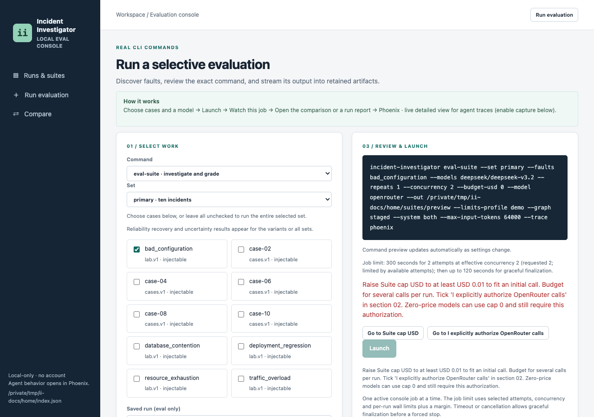
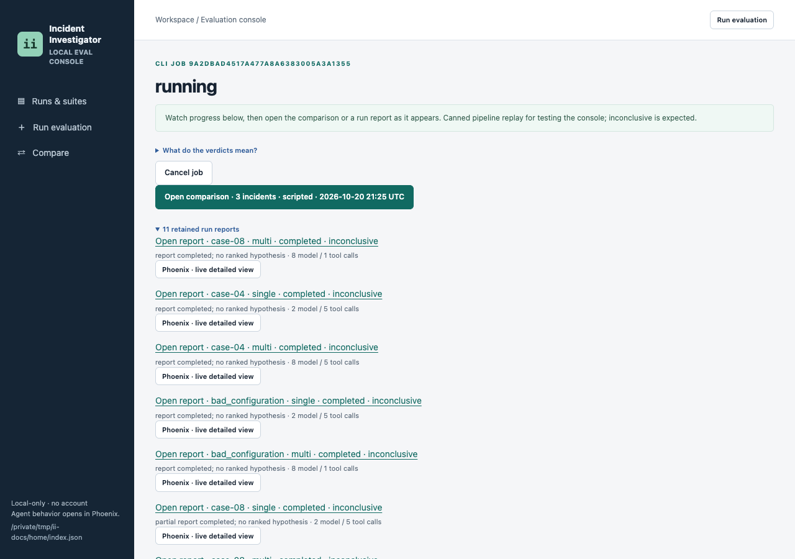
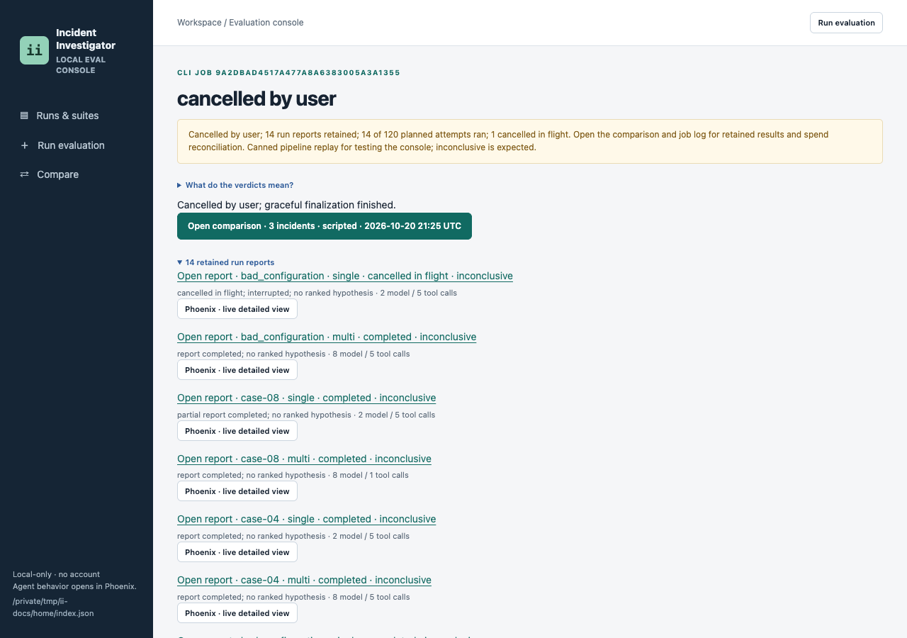
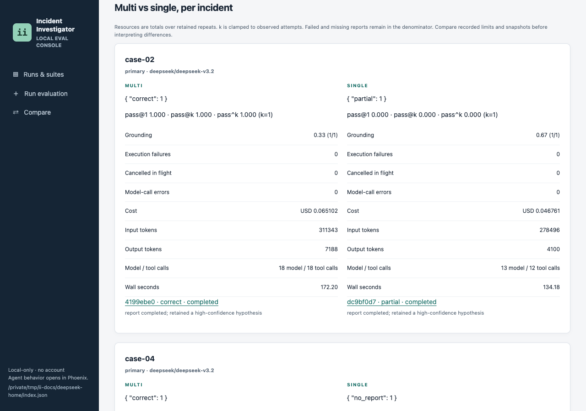

# Evaluation console guide

The console launches local CLI jobs and links their outputs: reports, frozen evidence, automatic grades, human review and suite comparisons. Every run writes its own trace. The Phoenix stack is optional: a separate viewer for model and tool spans. No frontend build or account is needed.

The screenshots were taken on 2026-10-21 at this head. Launch, job and cancel screens come from scripted runs with no provider key. Results screens show the retained DeepSeek V3.2 suite described in [evaluation](evaluation.md#multi-agent-vs-single-agent-results). No provider calls were made for this guide.

## Start the console

From the repository root, with `uv` and Python 3.13:

```sh
uv sync --locked
uv run incident-investigator console
```

Open **http://127.0.0.1:8765**. Output goes to the gitignored `var/` workspace. `II_HOME` selects another workspace and `--port` another port:

```sh
II_HOME=/tmp/ii-console uv run incident-investigator console --port 8766
```

Open **http://127.0.0.1:8766** for that command. New runs in the workspace appear automatically. The CLI `import` command indexes older artifact roots read-only.

## Start with Phoenix

Install the trace-export extra, then start a local Phoenix server in one terminal:

```sh
uv sync --locked --extra phoenix
PHOENIX_HOST=127.0.0.1 PHOENIX_PORT=6006 PHOENIX_WORKING_DIR=/tmp/ii-phoenix \
  uv tool run --from arize-phoenix phoenix serve
```

Phoenix also listens for gRPC on port 4317. If that port is taken, start-up fails with `Failed to bind to address [::]:4317`. Pick a free port:

```sh
PHOENIX_HOST=127.0.0.1 PHOENIX_PORT=6006 PHOENIX_GRPC_PORT=4417 PHOENIX_WORKING_DIR=/tmp/ii-phoenix \
  uv tool run --from arize-phoenix phoenix serve
```

Open **http://127.0.0.1:6006** to confirm it is ready. In another terminal:

```sh
II_PHOENIX_URL=http://127.0.0.1:6006 uv run --extra phoenix incident-investigator console
```

When Phoenix is reachable, **Capture in local Phoenix** is ticked by default, including for scripted runs. It adds `--trace phoenix` to the job command. To capture a CLI demo directly:

```sh
uv run --extra phoenix incident-investigator demo --model scripted \
  --script tests/scripted-demo.json --trace phoenix
```

Keep `--extra phoenix` on every `uv run` while exporting; a plain sync removes optional packages. Only unauthenticated loopback endpoints are accepted. Capture never enables provider calls.

## Run evaluation



*Choose cases on the left; the command preview and job limit update on the right.*

| Field | What it does |
| --- | --- |
| Command | `eval-suite` investigates and grades fresh attempts; `demo` runs one lab injection; `eval` grades a saved run |
| Set | `primary` (ten incidents), `variants` (R1 and R2) or `all` |
| Cases | The form opens with `bad_configuration` ticked. Tick cases to narrow the set, or untick all to run the whole set |
| Provider | `scripted` replays canned actions; `openrouter` calls a real model |
| System | `multi` (six roles), `single` (one investigator) or both on the same snapshots and limits |
| Limits profile | `demo` for local replays; `demo-live` gives live providers more time |
| Repeats, Concurrency | Attempts per case and system, and how many run at once |
| Suite cap USD | Spend cap shared by all attempts. 0 allows no paid calls |
| Per-run cap USD | Cap for each attempt within the suite cap. Blank inherits the suite cap |
| Per-call timeout, Run wall limit | Overrides for the profile; blank uses the profile value |
| Max input tokens | Prompts above this size are refused before sending |



*Section 02 with OpenRouter selected. The hint under the fields gives the minimum cap.*

The command preview updates as you change fields. **Launch** runs that command, with a fresh output directory named after the job.

### Launch budget check



*A paid model with Suite cap 0: Launch stays disabled and says what to change.*

Before an OpenRouter launch, the console reads the model's public prices and checks the caps.

- **Paid model:** Launch stays disabled until Suite cap USD (and Per-run cap USD, if set) fits one initial call. The minimum is shown, for example USD 0.01. It is a starting minimum, not a run estimate: a run can need up to 40 model calls.
- **Free model:** when public prices are zero, the hint reads "Free model: public prices are zero; no charge is reserved." Launch works at cap 0.
- **Authorization:** every OpenRouter launch, free or paid, needs **I explicitly authorize OpenRouter calls** ticked.
- **Key:** `OPENROUTER_API_KEY` must be set in the console's own environment. The browser never sees it.

The **Go to** buttons jump to the field that blocks the launch. Calls stop when the next reservation no longer fits the cap. See [evaluation](evaluation.md#cost-and-budget-interpretation) for how reserves settle.

### Job limit

The form shows the job limit before launch. It is computed, not fixed:

`ceil(attempts / concurrency) x run wall limit`, plus the larger of 60 seconds or 10%.

After the limit, or after Cancel, the job gets up to 120 seconds to finalize before a forced stop. For example, 12 attempts at concurrency 2 with the 240-second `demo` wall limit give 1,584 seconds. The output log is capped at two megabytes.

## Watch a job



*A running job: each finished or running attempt gets a row as soon as it exists.*

- **Live progress:** each run row shows its system, status, verdict and admitted calls. A running row shows the current stage, for example "gathering; 9 model / 18 tool calls admitted".
- **Open comparison** opens the suite page when both systems ran. With one system it reads **Open results**.
- **Open report** opens a run. **Phoenix · live detailed view** opens its trace while the run is still going.
- The banner names failures in plain words, for example "1 of 2 runs failed: single: output truncated".

One console job runs at a time. Closing the browser does not stop it; console shutdown does.

### Cancel

**Cancel job** asks: "Cancel this job? Running attempts will stop and no new attempts will start. Results so far will be kept. Spend already incurred still applies; spend records will be finalized where available."



*After Cancel: reports so far are kept, and the job says how many planned attempts ran.*

The interrupted attempt shows **cancelled in flight**. Attempts that never started are logged as "suite cancelled before admission". The suite page shows "Cancelled by user" and how many planned attempts never started.

## Runs and suites


*All attempts, with workspace totals above and filters below.*

Filter by Incident, Model, System, Set, Verdict or Suite. Sort by creation time, cost, wall time or verdict. The cards count the whole workspace; filters only select table rows. A retained run without a result is labeled unfinished.

Execution status and verdict are separate. **completed / inconclusive** means the run finished but named no supported cause. That is the expected scripted result.

## Suite comparison


*The header says how many planned attempts ran and what they cost. The system summary gives one plain sentence per incident.*

The **System summary** compares multi and single per incident. When one side did not finish, it says so and calls the pair "not a like-for-like comparison". When neither is correct, it lists resource differences instead of naming a winner.

The system table below it has one row per system:

| Column | Meaning |
| --- | --- |
| Outcome / why | Each attempt's verdict and a short reason, for example "stopped during single; output truncated" |
| Execution failures | Runs that stopped without completing reporting. Cancelled attempts are counted separately |
| Cancelled in flight | Attempts interrupted by Cancel |
| Model-call errors | Failed model requests, including retries and failures followed by a partial report |
| Diagnostic rate / pass@1 | Correct attempts divided by retained attempts |
| Mean pass@k / pass^k | Means across incidents, with k capped per incident |
| Grounding | Mean grounding with (measured/total) attempts; see [evaluation](evaluation.md#grounding) |



*Multi vs single, per incident: verdicts, grounding, failures, cost, tokens, calls and wall time side by side.*

**Primary accuracy** lists verdicts per incident and system. **Reliability** fills in for the `variants` or `all` sets: R1 exercised / recovered and R2 justified uncertainty. Change **k** and choose **Update** to recompute pass@k and pass^k. Expand **Recorded batch settings** before interpreting a result.

**What do the verdicts mean?** opens a short legend on the job and suite pages. Full definitions are in [evaluation](evaluation.md#automatic-verdicts).

## Run detail


*Report tab: execution, report and diagnosis status, then the summary, ranked hypotheses and cited evidence.*

The header links **Phoenix · live detailed view**, **Grade this run** and **Watch job**. Citation IDs open the retrieved observation or tool receipt. A receipt shows what retrieval returned; it cannot establish a cause by itself. **Open result.json** shows the retained structured state.

### Frozen evidence


*The complete frozen input, including records the run never retrieved.*

Filter by source, service and start/end time with explicit UTC offsets. A linked evidence ID is a record the run retrieved; a plain record ID is one it did not. The table shows up to 1,000 matching records. Older imported runs without a full snapshot show retrieved evidence only.

### Grade and Grade this run


*Grade tab: a one-line reason for the verdict, each check, and the expected answer.*

The expected answer is evaluator-only. It never enters prompts, source snapshots or model spans. Expand **Full grade checks and usage** for grounding, citations and resource totals.

**Grade this run** opens the launch form with `eval` and the saved run selected. Leave cases unticked to use the run's own expectation, or tick one to override it. This runs the offline grader into a new grading suite. It makes no model calls and does not change the run.

### Rubric

Record a score and reason for Diagnosis, Support, Contradictions, Uncertainty and Actions, then choose **Save human rubric**. Notes are workspace sidecars. They never overwrite the automatic verdict or reach investigator inputs.

## Compare

Choose **Compare** in the sidebar. Select **suites** or **runs**, pick Left and Right, then choose **Compare**. The suite view shows runs, correct verdicts, execution failures, calls, events, cost and summed wall seconds. It does not compute statistical significance. For multi vs single on the same incidents, use the suite comparison page instead.

## Known and unknown cost

A USD value means the recorded cost is complete. **unknown** means at least one component is missing, and a suite total stays unknown if any run lacks a cost. Known subtotals stay in the raw JSON; they are not the total bill. Zero-price models show "free model, no charge". Scripted runs show "scripted replay, no charge".

## Phoenix links

A traced run links its trace from the job page, the run header and the run list. An early session link can become a direct trace link after ingestion; refresh if Phoenix is still ingesting. **Phoenix · not captured** means no trace pointer was kept. The console and local artifacts still work without Phoenix.

## Limitations

The console is a loopback utility with no account or access control. Keep it local. POSTs need the console token and a same-origin request. The in-memory storage backend supports viewing and review but disables launching.

Automatic correctness is lexical and citation-based. Human review is still needed for causal support, contradictions and useful actions. A scripted suite tests the console and execution path, not diagnostic quality.
