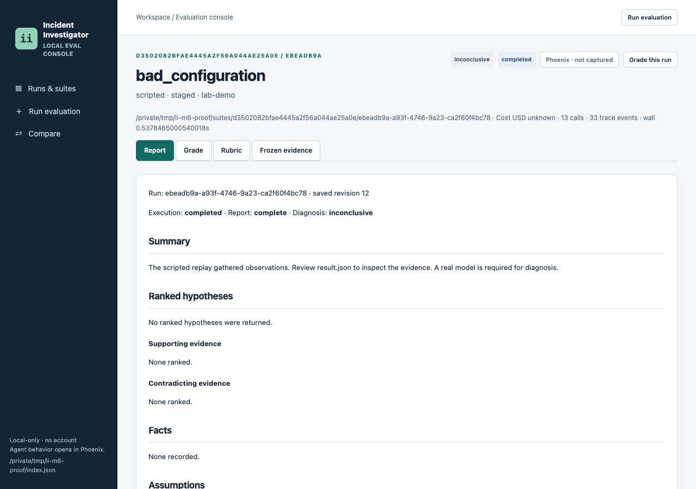
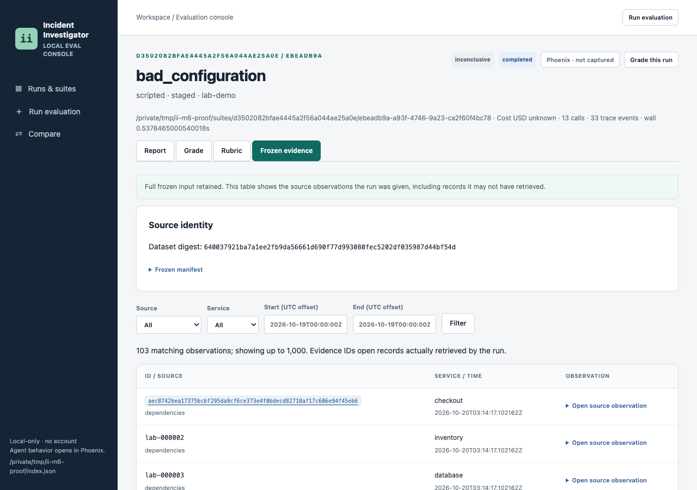

# Evaluation console guide

The console launches local CLI jobs and connects their outputs: reports, frozen evidence, automatic grades, human review and suite metrics. Every run writes its own trace. The Phoenix stack is optional: a separate viewer for model and tool spans. No frontend build or account is required.

The steps and five screenshots below were verified in a browser against a fresh workspace on 2026-10-20, using scripted runs without a provider key. They show behavior, not diagnostic accuracy. The primary suite used bad configuration and database contention, two repeats each, concurrency two and a zero budget. A separate scripted run verified Phoenix export and its trace link.

## Start without Phoenix

From the repository root, with `uv` and Python 3.13:

```sh
uv sync --locked
uv run incident-investigator console
```

Open **http://127.0.0.1:8765**. Output defaults to the gitignored `var/` workspace. Use `II_HOME` consistently to select another workspace; `--port` changes the console port:

```sh
II_HOME=/tmp/ii-console uv run incident-investigator console --port 8766
```

Open **http://127.0.0.1:8766** for that command. New runs under the selected workspace are discovered automatically. Existing external roots can be indexed through the CLI `import` command; they remain read-only. New jobs, grades and rubric sidecars stay in the workspace.

## Start with Phoenix

Install the trace-export extra, then start a separate local Phoenix server in one terminal:

```sh
uv sync --locked --extra phoenix
PHOENIX_HOST=127.0.0.1 PHOENIX_PORT=6006 PHOENIX_WORKING_DIR=/tmp/ii-phoenix \
  uv tool run --from arize-phoenix phoenix serve
```

Open **http://127.0.0.1:6006** to confirm it is ready. The tool command installs the separate viewer; the project extra installs the exporter. In another terminal:

```sh
II_PHOENIX_URL=http://127.0.0.1:6006 uv run --extra phoenix incident-investigator console
```

Check **Capture in local Phoenix** when launching a job. This adds `--trace phoenix` to the child command. To capture a CLI demo directly:

```sh
uv run --extra phoenix incident-investigator demo --model scripted \
  --script tests/scripted-demo.json --trace phoenix
```

Use `uv run --extra phoenix` while exporting to Phoenix; a normal dependency sync can remove optional packages. `II_PHOENIX=1` also enables Phoenix export for an invocation and its children. Only unauthenticated loopback HTTP endpoints are accepted. Phoenix export does not enable provider calls: scripted runs still use canned actions.

## Run evaluation

Choose **Run evaluation** in the sidebar.

1. Leave the command as `eval-suite`, which investigates and grades fresh attempts. Select **bad_configuration** and **database_contention**.
2. Leave Provider as **scripted**, Graph as **staged**, Limits profile as **demo** and Budget cap USD as **0**. Set Repeats to **2** and Concurrency to **2**. Leave provider confirmation unchecked.
3. Leave Phoenix capture unchecked for the first suite. Choose **Update command** and review the generated command.
4. Choose **Launch**. The job page streams subprocess output. Wait for **completed**, then follow a run link or return to **Runs & suites**.

The command choices have distinct purposes:

| Command | Use |
| --- | --- |
| `eval-suite` | Fresh independent lab investigations and automatic grades |
| `demo` | One injected fault, one repeat, scripted only in the console |
| `eval` | Grade an indexed saved run without another investigation |

The provider model field is used for OpenRouter, which requires a complete model ID, a server-side `OPENROUTER_API_KEY` and the explicit provider-call confirmation checkbox. Use `eval-suite` for provider calls so the shared monetary guard applies. Live providers usually need the `demo-live` profile. These provider steps were not executed during verification.

One console job can run at a time; its batch concurrency is configurable. Closing the browser does not stop it. Console shutdown stops its child process. Jobs have a one-hour timeout and a two-megabyte output log cap; individual investigations keep their own smaller execution limits. Failed attempts remain inspectable.

## Runs and suites


The landing page lists observed attempts and suite links. Filter by fault, model, recorded graph, verdict or suite; sort by creation time, cost, wall time or verdict. The summary cards cover the workspace, while filters select table rows. A retained run without a result is labeled unfinished, rather than assumed to still be running.

Execution status and diagnostic verdict are separate. A **completed / inconclusive** row means execution finished but the report did not identify a cause. That is the expected scripted result. A **completed / ungraded** row has not yet been automatically evaluated.

## Run detail and Report



Open a fault name to see its run detail.

Citation IDs open retrieved observations or tool receipts. A receipt describes what retrieval returned; it cannot establish an application cause by itself. Expand **Raw result.json** for the retained structured state. The stock replay deliberately supplies no diagnosis or factual report claims, so several sections are empty.

## Frozen evidence



This tab shows the complete retained input, including records the agent never retrieved. Filter by source, service and start/end timestamps with explicit UTC offsets. For example, select **checkout**, choose **Filter**, then expand an **Open source observation** row. A linked evidence ID opens the retrieved record; a plain source record ID identifies an input the run did not retrieve.

The table displays up to 1,000 matching records. The matching count can exceed the visible rows. Older imported runs without full snapshots explicitly show retrieved evidence only; that view does not reconstruct missing input.

## Grade and Grade this run


Expand **Full grade checks and usage** for grounding, citations, process checks and resource totals. The expected answer is evaluator-only and never enters investigator prompts, source snapshots or model spans.

To grade or regrade a saved run, choose **Grade this run**. The launch panel selects `eval` and the saved run. Leave faults unchecked to use its expectation pointer, or select exactly one known fault to override that pointer. Review the command and launch. This invokes the real offline grader and writes a separate grading suite; it does not make model calls or modify the original run. Return to the run's Grade tab after completion.

On **Rubric**, record a score and reason for Diagnosis, Support, Contradictions, Uncertainty and Actions, then choose **Save human rubric**. Unreviewed dimensions can stay unreviewed. Notes are stored as workspace sidecars, including for imported runs. They do not overwrite the automatic verdict or affect later investigator inputs.

## Suite detail and comparison


Open a suite link to see metrics grouped by fault, model and recorded workflow. Change **k** and choose **Update**. The example has two attempts per fault, so requested k=4 becomes effective k=2. Expand **Recorded batch settings** before interpreting a result.

Choose **Compare** in the sidebar, select **suites**, choose Left and Right, then choose **Compare**. The table shows observed runs, correct verdicts, execution failures, calls, events, total cost and summed run wall seconds. It does not compute paired statistical significance or align incidents automatically. Suite wall seconds are summed work, not the elapsed duration of concurrent batch execution. Select **runs** to compare verdict, execution status, model, graph and resources for two individual attempts.

## What the metrics mean

| Display | Meaning |
| --- | --- |
| Observed attempts / n | Retained attempts in the workspace or selected suite/group |
| Automatic correct / correct | Attempts that pass culprit, mechanism and cited-key-evidence checks |
| Execution failures / failures | Runs with failed or resource-exhausted execution status; different from wrong diagnoses |
| pass@1, pass@k, pass^k | Repeat-based success estimates; see [evaluation](evaluation.md#repeats-and-reliability-metrics) |
| Effective k | Requested k clamped to observed group size |
| Calls | Admitted model and tool attempts, including retries |
| Trace events / events | Local event records, including validation and transitions |
| Tokens in/out | Available input/output token usage; absent measurements remain unknown |
| Wall | Run elapsed time; suite comparison sums run times |
| Grounding/citation fractions | Provenance checks over hypotheses/references, not semantic entailment |

Failures and missing reports remain in observed denominators. Skipped or unstarted trials are recorded in batch settings rather than manufactured as observed attempts. The [evaluation guide](evaluation.md) gives exact pass estimators, verdict definitions and other raw grade measurements.

## Known and unknown cost

A numeric USD value means the corresponding recorded cost is complete. **unknown** means at least one required component is absent. A suite total stays unknown when any included run lacks a cost. The raw result and grade retain known subtotals separately; a known subtotal is not the total bill.

Scripted runs make no provider calls, but their adapter reports no token/cost usage. The screenshots therefore show unknown. This is expected. Provider timeouts or missing usage can likewise leave cost unknown while the budget guard retains conservative reserves. The budget cap and a displayed recorded cost answer different questions: admission capacity versus available billing evidence.

## Phoenix links

After a traced run starts, its header and run-list row can link to a Phoenix session or trace. Open **Open in Phoenix** to inspect role/model/tool spans, inputs, outputs, timing and available usage. An early session link can become a direct trace link after ingestion. Refresh if the local collector is still ingesting.

**Phoenix · not captured** means no usable pointer was retained. The console and local artifacts still work. Collector unavailability can prevent trace lookup even if export was enabled; it does not create missing billing measurements or replace SQLite recovery. The verification run opened its saved direct trace link and confirmed the investigation and worker spans in the separate viewer.

## Limitations

The console is a loopback utility with no account or production access control. Keep it local. POSTs require the console token and same-origin requests. The in-memory storage backend supports viewing/review but disables subprocess launching by default.

Automatic correctness is lexical and citation-based. Human review is required for causal support, contradictions and useful actions. Synthetic, development-exposed incidents and small repeat counts cannot establish production accuracy, calibrated confidence or multi-agent superiority. The matched benchmark remains pending. A scripted suite validates the UI and execution path, not those quality claims.
